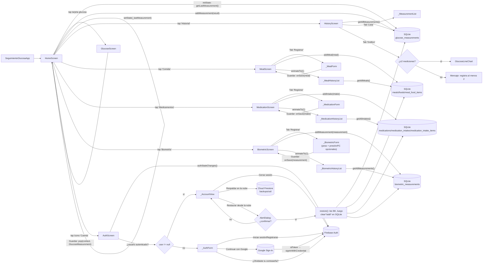

# PROJECT_GRAPH.md

Grafo de dependencias y flujo de navegación del proyecto `seguimiento_glucosa`,
generado a partir del análisis estático de `lib/` y `test/`.

> Actualizado el 2026-08-19 tras agregar respaldo/restauración manual
> en la nube (`BackupRepository`/`FirestoreBackupRepository`, sobre
> Cloud Firestore), **opcional** y disponible solo con sesión
> iniciada. `AuthScreen` → `_AccountView` ganó los botones "Respaldar
> en la nube" y "Restaurar desde la nube" (este último con un
> `AlertDialog` de confirmación, ya que **reemplaza** todos los datos
> locales en lugar de fusionarlos — no hay clave estable entre
> dispositivos para fusionar sin duplicados). `HomeScreen` ganó un
> flag `enableCloudBackup` (`false` por defecto, `true` solo desde
> `main.dart`) para que `FirestoreBackupRepository` no se construya
> automáticamente en los widget tests. Ningún repositorio de datos de
> salud (`GlucoseRepository`, `MealRepository`,
> `MedicationRepository`, `BiometricRepository`) ni `AppDatabase`
> cambiaron: SQLite sigue siendo el almacenamiento principal;
> Firestore solo guarda una copia de respaldo bajo demanda explícita.
>
> Cambio previo (mismo día): se agregó autenticación de usuarios
> (`AppUser`, `AuthRepository`/`FirebaseAuthRepository`, pantalla
> `AuthScreen`), **opcional**: no bloquea el resto de la app. Soporta
> correo/contraseña y Google (`google_sign_in` 7.x +
> `GoogleAuthProvider.credential` + `signInWithCredential`).
> `HomeScreen` ganó un ícono "Cuenta" en el `AppBar` que navega a
> `AuthScreen`; `main.dart` inicializa `GoogleSignIn` con el Web Client
> ID del proyecto antes de `runApp`.
>
> Cambio previo (mismo día): se integró Firebase (proyecto
> `seguimiento-glucosa`) como base de preparación para pasos futuros del
> roadmap. `lib/main.dart` inicializa `Firebase.initializeApp()` antes
> de `runApp`, usando las opciones generadas por `flutterfire configure`
> en `lib/firebase_options.dart`.
> `ios/Runner/GoogleService-Info.plist` (no generado por
> `flutterfire configure` al correr en Windows) se completó con
> `firebase apps:sdkconfig IOS` y se enlazó manualmente en
> `ios/Runner.xcodeproj/project.pbxproj`.
>
> Cambio previo (mismo día): se amplió el módulo de Biometría
> (`BiometricMeasurement`, `BiometricRepository`/
> `SqliteBiometricRepository`, pantalla `BiometricScreen` con pestañas
> **Registrar**/**Historial**) con presión arterial y frecuencia
> cardíaca opcionales, además del peso corporal obligatorio ya existente
> (el IMC queda pendiente hasta que exista un perfil de usuario con
> altura). El módulo de Biometría se suma al módulo de Medicamentos
> (`Medication`/`MedicationIntake`/`MedicationIntakeItem`,
> `MedicationRepository`/`SqliteMedicationRepository`, pantalla
> `MedicationScreen`) y al módulo de Comidas (`Food`/`Meal`/
> `MealFoodItem`, `MealRepository`/`SqliteMealRepository`, pantalla
> `MealScreen`). El gestor compartido de base de datos `AppDatabase`
> administra 8 tablas SQLite (`glucose_measurements`, `foods`, `meals`,
> `meal_food_items`, `medications`, `medication_intakes`,
> `medication_intake_items`, `biometric_measurements`) con migraciones
> versionadas (`_schemaVersion = 5`; la versión 5 agregó las columnas
> `systolic_pressure`, `diastolic_pressure` y `heart_rate_bpm` a
> `biometric_measurements`).

---

## 1. Grafo de dependencias entre archivos (imports)

```text
lib/main.dart
 └─ imports: package:firebase_core/firebase_core.dart
 └─ imports: package:flutter/material.dart
 └─ imports: lib/firebase_options.dart
 │    └─ imports: package:firebase_core/firebase_core.dart
 │    └─ imports: package:flutter/foundation.dart
 └─ imports: lib/services/firebase_auth_repository.dart
 │    └─ imports: package:firebase_auth/firebase_auth.dart
 │    └─ imports: package:google_sign_in/google_sign_in.dart
 │    └─ imports: lib/models/app_user.dart
 │    └─ imports: lib/services/auth_repository.dart
 │         └─ imports: lib/models/app_user.dart
 └─ imports: lib/screens/home_screen.dart
      └─ imports: package:flutter/material.dart
      └─ imports: lib/models/glucose_measurement.dart
      └─ imports: lib/services/app_database.dart
      └─ imports: lib/services/auth_repository.dart
      └─ imports: lib/services/firebase_auth_repository.dart
      └─ imports: lib/services/backup_repository.dart
      └─ imports: lib/services/firestore_backup_repository.dart
      │    └─ imports: package:cloud_firestore/cloud_firestore.dart
      │    └─ imports: package:firebase_auth/firebase_auth.dart
      │    └─ imports: lib/models/biometric_measurement.dart
      │    └─ imports: lib/models/food.dart
      │    └─ imports: lib/models/glucose_measurement.dart
      │    └─ imports: lib/models/meal.dart
      │    └─ imports: lib/models/medication.dart
      │    └─ imports: lib/models/medication_intake.dart
      │    └─ imports: lib/services/backup_repository.dart
      │    └─ imports: lib/services/biometric_repository.dart
      │    └─ imports: lib/services/glucose_repository.dart
      │    └─ imports: lib/services/meal_repository.dart
      │    └─ imports: lib/services/medication_repository.dart
      │    └─ imports: package:path/path.dart
      │    └─ imports: package:sqflite/sqflite.dart
      └─ imports: lib/services/glucose_repository.dart
      │    └─ imports: package:sqflite/sqflite.dart
      │    └─ imports: lib/models/glucose_measurement.dart
      │    └─ imports: lib/services/app_database.dart
      └─ imports: lib/services/meal_repository.dart
      │    └─ imports: package:sqflite/sqflite.dart
      │    └─ imports: lib/models/food.dart
      │    └─ imports: lib/models/meal.dart
      │    │    └─ imports: lib/models/food.dart
      │    └─ imports: lib/services/app_database.dart
      └─ imports: lib/services/medication_repository.dart
      │    └─ imports: package:sqflite/sqflite.dart
      │    └─ imports: lib/models/medication.dart
      │    └─ imports: lib/models/medication_intake.dart
      │    │    └─ imports: lib/models/medication.dart
      │    └─ imports: lib/services/app_database.dart
      └─ imports: lib/services/biometric_repository.dart
      │    └─ imports: package:sqflite/sqflite.dart
      │    └─ imports: lib/models/biometric_measurement.dart
      │    └─ imports: lib/services/app_database.dart
      └─ imports: lib/screens/glucose_screen.dart
      │    └─ imports: package:flutter/material.dart
      │    └─ imports: lib/models/glucose_measurement.dart
      └─ imports: lib/screens/history_screen.dart
      │    └─ imports: package:flutter/material.dart
      │    └─ imports: package:intl/intl.dart
      │    └─ imports: lib/models/glucose_measurement.dart
      │    └─ imports: lib/services/glucose_repository.dart
      │    └─ imports: lib/widgets/glucose_line_chart.dart
      │         └─ imports: package:fl_chart/fl_chart.dart
      │         └─ imports: package:flutter/material.dart
      │         └─ imports: package:intl/intl.dart
      │         └─ imports: lib/models/glucose_measurement.dart
      └─ imports: lib/screens/meal_screen.dart
      │    └─ imports: package:flutter/material.dart
      │    └─ imports: package:intl/intl.dart
      │    └─ imports: lib/models/food.dart
      │    └─ imports: lib/models/meal.dart
      │    └─ imports: lib/services/meal_repository.dart
      └─ imports: lib/screens/medication_screen.dart
      │    └─ imports: package:flutter/material.dart
      │    └─ imports: package:intl/intl.dart
      │    └─ imports: lib/models/medication.dart
      │    └─ imports: lib/models/medication_intake.dart
      │    └─ imports: lib/services/medication_repository.dart
      └─ imports: lib/screens/biometric_screen.dart
      │    └─ imports: package:flutter/material.dart
      │    └─ imports: package:intl/intl.dart
      │    └─ imports: lib/models/biometric_measurement.dart
      │    └─ imports: lib/services/biometric_repository.dart
      └─ imports: lib/screens/auth_screen.dart
           └─ imports: package:flutter/material.dart
           └─ imports: lib/models/app_user.dart
           └─ imports: lib/services/auth_repository.dart
           └─ imports: lib/services/backup_repository.dart

test/widget_test.dart
 └─ imports: dart:async
 └─ imports: package:fl_chart/fl_chart.dart
 └─ imports: package:flutter/material.dart
 └─ imports: package:flutter_test/flutter_test.dart
 └─ imports: package:seguimiento_glucosa/models/app_user.dart
 └─ imports: package:seguimiento_glucosa/models/biometric_measurement.dart
 └─ imports: package:seguimiento_glucosa/models/food.dart
 └─ imports: package:seguimiento_glucosa/models/glucose_measurement.dart
 └─ imports: package:seguimiento_glucosa/models/meal.dart
 └─ imports: package:seguimiento_glucosa/models/medication.dart
 └─ imports: package:seguimiento_glucosa/models/medication_intake.dart
 └─ imports: package:seguimiento_glucosa/screens/home_screen.dart
 └─ imports: package:seguimiento_glucosa/services/auth_repository.dart
 └─ imports: package:seguimiento_glucosa/services/backup_repository.dart
 └─ imports: package:seguimiento_glucosa/services/biometric_repository.dart
 └─ imports: package:seguimiento_glucosa/services/glucose_repository.dart
 └─ imports: package:seguimiento_glucosa/services/meal_repository.dart
 └─ imports: package:seguimiento_glucosa/services/medication_repository.dart

test/services/glucose_repository_test.dart
 └─ imports: package:flutter_test/flutter_test.dart
 └─ imports: package:sqflite_common_ffi/sqflite_ffi.dart
 └─ imports: package:seguimiento_glucosa/models/glucose_measurement.dart
 └─ imports: package:seguimiento_glucosa/services/glucose_repository.dart

test/services/meal_repository_test.dart
 └─ imports: package:flutter_test/flutter_test.dart
 └─ imports: package:sqflite_common_ffi/sqflite_ffi.dart
 └─ imports: package:seguimiento_glucosa/models/food.dart
 └─ imports: package:seguimiento_glucosa/models/meal.dart
 └─ imports: package:seguimiento_glucosa/services/meal_repository.dart

test/services/medication_repository_test.dart
 └─ imports: package:flutter_test/flutter_test.dart
 └─ imports: package:sqflite_common_ffi/sqflite_ffi.dart
 └─ imports: package:seguimiento_glucosa/models/medication.dart
 └─ imports: package:seguimiento_glucosa/models/medication_intake.dart
 └─ imports: package:seguimiento_glucosa/services/medication_repository.dart

test/services/biometric_repository_test.dart
 └─ imports: package:flutter_test/flutter_test.dart
 └─ imports: package:sqflite_common_ffi/sqflite_ffi.dart
 └─ imports: package:seguimiento_glucosa/models/biometric_measurement.dart
 └─ imports: package:seguimiento_glucosa/services/biometric_repository.dart
```

### Representación Mermaid

```mermaid
graph TD
    main["lib/main.dart"] --> firebaseOpts["lib/firebase_options.dart"]
    main["lib/main.dart"] --> authRepoImpl["lib/services/firebase_auth_repository.dart"]
    main["lib/main.dart"] --> home["lib/screens/home_screen.dart"]
    home --> glucose["lib/screens/glucose_screen.dart"]
    home --> model["lib/models/glucose_measurement.dart"]
    home --> db["lib/services/app_database.dart"]
    home --> repo["lib/services/glucose_repository.dart"]
    home --> mealRepo["lib/services/meal_repository.dart"]
    home --> medRepo["lib/services/medication_repository.dart"]
    home --> bioRepo["lib/services/biometric_repository.dart"]
    home --> authRepo["lib/services/auth_repository.dart"]
    home --> authRepoImpl
    home --> backupRepo["lib/services/backup_repository.dart"]
    home --> backupRepoImpl["lib/services/firestore_backup_repository.dart"]
    home --> history["lib/screens/history_screen.dart"]
    home --> mealScreen["lib/screens/meal_screen.dart"]
    home --> medScreen["lib/screens/medication_screen.dart"]
    home --> bioScreen["lib/screens/biometric_screen.dart"]
    home --> authScreen["lib/screens/auth_screen.dart"]
    glucose --> model
    repo --> model
    repo --> db
    mealRepo --> db
    mealRepo --> food["lib/models/food.dart"]
    mealRepo --> meal["lib/models/meal.dart"]
    meal --> food
    medRepo --> db
    medRepo --> medication["lib/models/medication.dart"]
    medRepo --> intake["lib/models/medication_intake.dart"]
    intake --> medication
    bioRepo --> db
    bioRepo --> bioModel["lib/models/biometric_measurement.dart"]
    history --> model
    history --> repo
    history --> chart["lib/widgets/glucose_line_chart.dart"]
    chart --> model
    mealScreen --> food
    mealScreen --> meal
    mealScreen --> mealRepo
    medScreen --> medication
    medScreen --> intake
    medScreen --> medRepo
    bioScreen --> bioModel
    bioScreen --> bioRepo
    authRepoImpl --> authUser["lib/models/app_user.dart"]
    authRepoImpl --> authRepo
    authRepo --> authUser
    authScreen --> authUser
    authScreen --> authRepo
    authScreen --> backupRepo
    backupRepoImpl --> backupRepo
    backupRepoImpl --> model
    backupRepoImpl --> food
    backupRepoImpl --> meal
    backupRepoImpl --> medication
    backupRepoImpl --> intake
    backupRepoImpl --> bioModel
    backupRepoImpl --> repo
    backupRepoImpl --> mealRepo
    backupRepoImpl --> medRepo
    backupRepoImpl --> bioRepo

    widget_test["test/widget_test.dart"] --> model
    widget_test --> food
    widget_test --> meal
    widget_test --> medication
    widget_test --> intake
    widget_test --> bioModel
    widget_test --> home
    widget_test --> repo
    widget_test --> mealRepo
    widget_test --> medRepo
    widget_test --> bioRepo
    widget_test --> authRepo
    widget_test --> backupRepo
    repo_test["test/services/glucose_repository_test.dart"] --> model
    repo_test --> repo
    meal_repo_test["test/services/meal_repository_test.dart"] --> food
    meal_repo_test --> meal
    meal_repo_test --> mealRepo
    bio_repo_test["test/services/biometric_repository_test.dart"] --> bioModel
    bio_repo_test --> bioRepo
    med_repo_test["test/services/medication_repository_test.dart"] --> medication
    med_repo_test --> intake
    med_repo_test --> medRepo

    pkg_material["package:flutter/material.dart"]
    pkg_test["package:flutter_test/flutter_test.dart"]
    pkg_intl["package:intl/intl.dart"]
    pkg_sqflite["package:sqflite/sqflite.dart"]
    pkg_sqflite_ffi["package:sqflite_common_ffi/sqflite_ffi.dart"]
    pkg_path["package:path/path.dart"]
    pkg_fl_chart["package:fl_chart/fl_chart.dart"]

    main --> pkg_material
    home --> pkg_material
    glucose --> pkg_material
    history --> pkg_material
    history --> pkg_intl
    mealScreen --> pkg_material
    mealScreen --> pkg_intl
    medScreen --> pkg_material
    medScreen --> pkg_intl
    bioScreen --> pkg_material
    bioScreen --> pkg_intl
    chart --> pkg_material
    chart --> pkg_intl
    chart --> pkg_fl_chart
    db --> pkg_sqflite
    db --> pkg_path
    repo --> pkg_sqflite
    mealRepo --> pkg_sqflite
    medRepo --> pkg_sqflite
    bioRepo --> pkg_sqflite
    widget_test --> pkg_material
    widget_test --> pkg_test
    widget_test --> pkg_fl_chart
    repo_test --> pkg_test
    repo_test --> pkg_sqflite_ffi
    meal_repo_test --> pkg_test
    meal_repo_test --> pkg_sqflite_ffi
    med_repo_test --> pkg_test
    med_repo_test --> pkg_sqflite_ffi
    bio_repo_test --> pkg_test
    bio_repo_test --> pkg_sqflite_ffi
```



`lib/models/glucose_measurement.dart`, `lib/models/food.dart`,
`lib/models/meal.dart`, `lib/models/medication.dart`,
`lib/models/medication_intake.dart`,
`lib/models/biometric_measurement.dart` y `lib/models/app_user.dart` no
dependen de Flutter: son módulos de Dart puro, lo que facilita
probarlos de forma aislada sin `flutter_test`. `lib/services/app_database.dart`,
`lib/services/glucose_repository.dart`,
`lib/services/meal_repository.dart`,
`lib/services/medication_repository.dart` y
`lib/services/biometric_repository.dart` tampoco dependen de Flutter
(solo de `sqflite`/`path`), por lo que `SqliteGlucoseRepository`,
`SqliteMealRepository`, `SqliteMedicationRepository` y
`SqliteBiometricRepository` se pueden probar directamente con
`sqflite_common_ffi` sin `flutter_test`. `lib/services/auth_repository.dart`
(la interfaz) tampoco depende de Flutter ni de Firebase, solo de
`lib/models/app_user.dart`, lo que permite el `_FakeAuthRepository` de
`test/widget_test.dart` sin tocar `firebase_auth`/`google_sign_in`.
`lib/services/backup_repository.dart` (la interfaz) tampoco depende de
Flutter ni de Firebase, solo de los modelos de dominio, lo que permite
el `_FakeBackupRepository` de `test/widget_test.dart` sin tocar
`cloud_firestore`. `fl_chart` es la única dependencia externa que no es
`flutter`/`intl`/`sqflite`/`path`/`firebase_*`/`google_sign_in`/`cloud_firestore`,
y es 100% Dart puro (sin plugins nativos). `firebase_core`,
`firebase_auth`, `google_sign_in` y `cloud_firestore` son plugins con
código nativo (Android/iOS), usados solo desde `lib/main.dart`,
`lib/services/firebase_auth_repository.dart` y
`lib/services/firestore_backup_repository.dart`; ningún modelo,
repositorio de datos de salud ni pantalla de dominio
(Glucosa/Comida/Medicamentos/Biometría/Historial) depende de ellos, por
lo que no afectan la testabilidad de esa lógica existente. `HomeScreen`
solo construye `FirestoreBackupRepository` cuando `enableCloudBackup`
es `true` (por defecto `false`, activado únicamente desde `main.dart`),
protegiendo también los widget tests de autenticación de tocar
Firestore real.

---

## 2. Grafo de clases y widgets

```text
main() (Future<void>, async)                 [lib/main.dart]
 ├─ WidgetsFlutterBinding.ensureInitialized()
 ├─ await Firebase.initializeApp(options: DefaultFirebaseOptions.currentPlatform)
 ├─ authRepository = FirebaseAuthRepository()
 ├─ await authRepository.initializeGoogleSignIn(serverClientId: _googleSignInServerClientId)
 └─ runApp(SeguimientoGlucosaApp(authRepository: authRepository))

SeguimientoGlucosaApp (StatelessWidget)      [lib/main.dart]
 └─ constructor({authRepository})    # FirebaseAuthRepository? ya inicializado
 └─ build() → MaterialApp
      └─ home: HomeScreen(authRepository: authRepository)

HomeScreen (StatefulWidget)                  [lib/screens/home_screen.dart]
 └─ constructor({repository, mealRepository, medicationRepository, biometricRepository, authRepository, backupRepository, enableCloudBackup = false})
 └─ createState() → _HomeScreenState
      ├─ _sharedDatabase: AppDatabase    # late final; solo se construye si se necesita
      ├─ _repository: GlucoseRepository = widget.repository ?? SqliteGlucoseRepository.withDatabase(_sharedDatabase)
      ├─ _mealRepository: MealRepository = widget.mealRepository ?? SqliteMealRepository.withDatabase(_sharedDatabase)
      ├─ _medicationRepository: MedicationRepository = widget.medicationRepository ?? SqliteMedicationRepository.withDatabase(_sharedDatabase)
      ├─ _biometricRepository: BiometricRepository = widget.biometricRepository ?? SqliteBiometricRepository.withDatabase(_sharedDatabase)
      ├─ _authRepository: AuthRepository = widget.authRepository ?? FirebaseAuthRepository()
      ├─ _backupRepository: BackupRepository? = widget.backupRepository ??
      │     (enableCloudBackup ? FirestoreBackupRepository(...) : null)
      │     # NO usa `??` con una implementación real incondicional (a diferencia
      │     # de los demás repos): requiere `enableCloudBackup=true` explícito,
      │     # para no tocar Firestore real en los widget tests por defecto
      ├─ _lastMeasurement: GlucoseMeasurement?
      ├─ _isLoading: bool
      ├─ initState() → _loadLastMeasurement()
      │     → await _repository.getLastMeasurement() → setState(_lastMeasurement, _isLoading = false)
      ├─ _openGlucoseScreen() → await Navigator.push<GlucoseMeasurement>
      │     → al recibir resultado no nulo:
      │           await _repository.addMeasurement(result)
      │           → setState(_lastMeasurement = saved)
      ├─ _openHistoryScreen() → Navigator.push(HistoryScreen(repository: _repository))
      ├─ _openMealScreen() → Navigator.push(MealScreen(repository: _mealRepository))
      ├─ _openMedicationScreen() → Navigator.push(MedicationScreen(repository: _medicationRepository))
      ├─ _openBiometricScreen() → Navigator.push(BiometricScreen(repository: _biometricRepository))
      ├─ _openAuthScreen() → Navigator.push(AuthScreen(repository: _authRepository, backupRepository: _backupRepository))
      └─ build() → Scaffold
           ├─ AppBar(actions: [IconButton(Icons.account_circle_outlined, tooltip: 'Cuenta', onPressed: _openAuthScreen)])
           └─ Column
                ├─ _GlucoseCard(measurement: _lastMeasurement, isLoading: _isLoading, onTap: _openGlucoseScreen)
                ├─ MenuButton(icon: restaurant,    title: 'Comida', onTap: _openMealScreen)
                ├─ MenuButton(icon: medication,    title: 'Medicamentos', onTap: _openMedicationScreen)
                ├─ MenuButton(icon: favorite,      title: 'Biometría', onTap: _openBiometricScreen)
                └─ MenuButton(icon: show_chart,    title: 'Historial', onTap: _openHistoryScreen)

_GlucoseCard (StatelessWidget, privado)      [lib/screens/home_screen.dart]
 └─ build() → Card
      ├─ si isLoading → CircularProgressIndicator
      ├─ si measurement == null → '-- mg/dL'
      └─ si measurement != null → '{value} mg/dL' + moment.label

MenuButton (StatelessWidget)                 [lib/screens/home_screen.dart]
 └─ constructor({icon, title, onTap})    # onTap opcional: null en módulos pendientes
 └─ build() → Card(ListTile(icon, title, trailing: arrow, onTap))

GlucoseRepository (interfaz abstracta)       [lib/services/glucose_repository.dart]
 ├─ getLastMeasurement() → Future<GlucoseMeasurement?>
 ├─ getAllMeasurements() → Future<List<GlucoseMeasurement>>   # más reciente → más antigua
 ├─ addMeasurement(GlucoseMeasurement) → Future<GlucoseMeasurement>   # asigna id
 └─ clearMeasurements() → Future<void>

SqliteGlucoseRepository (implements GlucoseRepository)  [lib/services/glucose_repository.dart]
 ├─ constructor({factory, databasePath, singleInstance})  # inyectables para tests (sqflite_common_ffi)
 ├─ tabla `glucose_measurements` (id, value, moment, measured_at, comment)
 ├─ _db: Future<Database>    # abre/reutiliza la conexión de forma perezosa
 └─ _fromRow / _toRow         # mapeo fila SQLite ↔ GlucoseMeasurement

HistoryScreen (StatefulWidget)               [lib/screens/history_screen.dart]
 └─ constructor({required repository})
 └─ createState() → _HistoryScreenState
      ├─ _measurementsFuture = repository.getAllMeasurements()   # una sola carga
      └─ build() → DefaultTabController(length: 2)
           └─ Scaffold
                ├─ AppBar('Historial') + TabBar(['Lista', 'Gráfico'])
                └─ FutureBuilder<List<GlucoseMeasurement>>
                     ├─ cargando → CircularProgressIndicator
                     ├─ vacío → Text('Todavía no hay mediciones registradas.')
                     └─ con datos → TabBarView
                          ├─ _MeasurementList(measurements)
                          └─ _MeasurementChart(measurements)

_MeasurementList (StatelessWidget, privado)  [lib/screens/history_screen.dart]
 └─ build() → ListView.separated(_MeasurementTile por cada medición)

_MeasurementChart (StatelessWidget, privado) [lib/screens/history_screen.dart]
 └─ build()
      ├─ si measurements.length < 2 → Text('Registra al menos dos mediciones...')
      └─ si length >= 2 → GlucoseLineChart(measurements)

_MeasurementTile (StatelessWidget, privado)  [lib/screens/history_screen.dart]
 └─ build() → ListTile(icon, '{value} mg/dL · {moment.label}', fecha/hora + comentario)

GlucoseLineChart (StatelessWidget)           [lib/widgets/glucose_line_chart.dart]
 ├─ constructor({required measurements})    # requiere ≥2 elementos
 ├─ _lowReference = 70, _highReference = 180   # mg/dL, líneas guía
 └─ build() → LineChart (fl_chart)
      ├─ ordena measurements cronológicamente → FlSpot por índice
      ├─ minY/maxY calculados a partir de valores + referencias ± margen
      ├─ titlesData.bottomTitles → _bottomLabel(value, measurements)  # fecha dd/MM
      ├─ extraLinesData → HorizontalLine en 70 y 180 (punteadas)
      └─ lineTouchData.touchTooltipData → LineTooltipItem('{value} mg/dL\n{fecha}')

AuthRepository (interfaz abstracta)          [lib/services/auth_repository.dart]
 ├─ authStateChanges() → Stream<AppUser?>
 ├─ currentUser → AppUser?
 ├─ registerWithEmail({email, password}) → Future<AppUser>
 ├─ signInWithEmail({email, password}) → Future<AppUser>
 ├─ signInWithGoogle() → Future<AppUser?>   # null si el usuario cancela
 ├─ sendPasswordResetEmail(email) → Future<void>
 └─ signOut() → Future<void>

AuthException (Exception)                   [lib/services/auth_repository.dart]
 └─ message: String    # ya traducido a español, sin códigos internos del SDK

FirebaseAuthRepository (implements AuthRepository)  [lib/services/firebase_auth_repository.dart]
 ├─ constructor({firebaseAuth, googleSignIn})  # inyectables para tests
 ├─ initializeGoogleSignIn({required serverClientId})   # se llama una vez desde main()
 ├─ signInWithGoogle(): GoogleSignIn.authenticate() → idToken →
 │     GoogleAuthProvider.credential(idToken) → signInWithCredential()
 └─ _messageForCode(code): traduce FirebaseAuthException.code → mensaje en español

AuthScreen (StatefulWidget)                  [lib/screens/auth_screen.dart]
 └─ constructor({required repository, backupRepository})    # backupRepository opcional
 └─ createState() → _AuthScreenState
      └─ build() → Scaffold(AppBar('Cuenta'))
           └─ StreamBuilder<AppUser?>(repository.authStateChanges(), initialData: repository.currentUser)
                ├─ user != null → _AccountView(user, repository, backupRepository)
                └─ user == null → _AuthForm(repository)

BackupRepository (interfaz abstracta)        [lib/services/backup_repository.dart]
 ├─ backup() → Future<void>   # sube todos los datos locales, sobrescribe el respaldo anterior
 ├─ restore() → Future<void>  # REEMPLAZA (no fusiona) los datos locales por los de la nube
 └─ getLastBackupTime() → Future<DateTime?>

BackupException (Exception)                  [lib/services/backup_repository.dart]
 └─ message: String    # ya traducido a español

FirestoreBackupRepository (implements BackupRepository)  [lib/services/firestore_backup_repository.dart]
 ├─ constructor({firebaseAuth, firestore, required glucoseRepository, mealRepository, medicationRepository, biometricRepository})
 ├─ documento único `backups/{uid}` con 4 listas serializadas + updatedAt (serverTimestamp)
 ├─ backup(): lee las 4 colecciones → serializa → Firestore.set()
 ├─ restore(): lee y valida el documento remoto primero; solo si existe,
 │     limpia (clear*) e inserta (add*) en los 4 repositorios locales
 └─ _glucoseToMap/_mealToMap/_intakeToMap/_biometricToMap (+ sus inversos)

_AccountView (StatefulWidget, privado)       [lib/screens/auth_screen.dart]
 └─ constructor({user, repository, backupRepository})
 └─ createState() → _AccountViewState
      ├─ _isBusy: bool, _statusMessage: String?
      ├─ _backup() → backupRepository.backup() → setState(_statusMessage)
      ├─ _confirmAndRestore() → showDialog(AlertDialog de confirmación)
      │     → si confirmado: backupRepository.restore() → setState(_statusMessage)
      └─ build() → ícono + displayName/email
           + si backupRepository != null: botones "Respaldar en la nube"/
             "Restaurar desde la nube"
           + botón "Cerrar sesión" → repository.signOut()

_AuthForm (StatefulWidget, privado)          [lib/screens/auth_screen.dart]
 └─ createState() → _AuthFormState
      ├─ _mode: _AuthMode (signIn | register)
      ├─ _submitEmailForm() → registerWithEmail/signInWithEmail según _mode
      ├─ _submitGoogleSignIn() → repository.signInWithGoogle()
      ├─ _sendPasswordReset() → repository.sendPasswordResetEmail(email)
      └─ build() → Form con campos correo/contraseña, botón principal,
            alternancia Iniciar sesión/Registrarse, "¿Olvidaste tu
            contraseña?" y botón "Continuar con Google"

AppDatabase (clase)                          [lib/services/app_database.dart]
 ├─ constructor({factory, databasePath, singleInstance})  # inyectables para tests
 ├─ database: Future<Database>    # getter perezoso; abre/reutiliza la conexión
 ├─ _schemaVersion = 5
 ├─ onConfigure → 'PRAGMA foreign_keys = ON'   # necesario para ON DELETE CASCADE
 ├─ _createAll(db)   # crea las 8 tablas (instalación nueva)
 └─ _upgrade(db, oldVersion)   # oldVersion<2 → tablas de comidas; oldVersion<3 → tablas de medicamentos; oldVersion<4 → tabla de biometría; oldVersion<5 → ALTER TABLE biometric_measurements ADD systolic_pressure/diastolic_pressure/heart_rate_bpm

MealRepository (interfaz abstracta)          [lib/services/meal_repository.dart]
 ├─ getAllMeals() → Future<List<Meal>>   # más reciente → más antigua, con items
 ├─ addMeal(Meal) → Future<Meal>   # resuelve/crea alimentos del catálogo
 ├─ clearMeals() → Future<void>
 └─ getAllFoods() → Future<List<Food>>

SqliteMealRepository (implements MealRepository)  [lib/services/meal_repository.dart]
 ├─ constructor({factory, databasePath, singleInstance}) / .withDatabase(AppDatabase)
 ├─ tablas `meals`, `foods`, `meal_food_items`
 ├─ addMeal() → db.transaction(...)   # inserta meal + resuelve/crea cada food + inserta items
 ├─ _resolveFoodId(txn, name)   # reutiliza food existente por nombre (trim) o lo crea
 └─ _getItemsForMeal(db, mealId)   # JOIN meal_food_items + foods

MealScreen (StatefulWidget)                  [lib/screens/meal_screen.dart]
 └─ constructor({required repository})
 └─ createState() → _MealScreenState (with SingleTickerProviderStateMixin)
      ├─ _tabController: TabController(length: 2)
      ├─ _mealsFuture = repository.getAllMeals()
      ├─ _handleMealSaved(meal) → await repository.addMeal(meal)
      │     → setState(_mealsFuture = ...) → _tabController.animateTo(1) → SnackBar
      └─ build() → Scaffold
           ├─ AppBar('Comida') + TabBar(['Registrar', 'Historial'])
           └─ TabBarView
                ├─ _MealForm(onSave: _handleMealSaved)
                └─ _MealHistoryList(mealsFuture: _mealsFuture)

_MealForm (StatefulWidget, privado)          [lib/screens/meal_screen.dart]
 ├─ _selectedType: MealType = breakfast; _items: List<_DraftFoodItem>
 ├─ _addItem() / _removeItem(index)
 ├─ _save() → valida ≥1 alimento → construye Meal → widget.onSave(meal) → limpia formulario
 └─ build() → Form
      ├─ DropdownButtonFormField<MealType>
      ├─ _FoodItemInputRow(foodNameController, quantityController, onAdd: _addItem)
      ├─ _FoodItemsList(items: _items, onRemove: _removeItem)
      ├─ TextField (comentario opcional)
      └─ ElevatedButton('Guardar') → _save

_MealHistoryList (StatelessWidget, privado)  [lib/screens/meal_screen.dart]
 └─ build() → FutureBuilder<List<Meal>>
      ├─ cargando → CircularProgressIndicator
      ├─ vacío → Text('Todavía no hay comidas registradas.')
      └─ con datos → ListView.separated(_MealTile por cada comida)

_MealTile (StatelessWidget, privado)         [lib/screens/meal_screen.dart]
 └─ build() → ListTile(tipo, fecha/hora + resumen alimentos + comentario)

Food (clase inmutable)                       [lib/models/food.dart]
 ├─ id: int?
 ├─ name: String
 └─ ==, hashCode, toString()

Meal (clase inmutable)                       [lib/models/meal.dart]
 ├─ id: int?; type: MealType; eatenAt: DateTime; comment: String?; items: List<MealFoodItem>
 └─ copyWith(...), ==, hashCode, toString()

MealFoodItem (clase inmutable)               [lib/models/meal.dart]
 ├─ id: int?; food: Food; quantity: String
 └─ ==, hashCode, toString()

MealType (enum) + MealTypeLabel (extension)  [lib/models/meal.dart]
 └─ breakfast, lunch, snack, dinner, other
    → label: String ('Desayuno', 'Almuerzo', 'Once/Merienda', 'Cena', 'Otro/Snack')

MedicationRepository (interfaz abstracta)    [lib/services/medication_repository.dart]
 ├─ getAllIntakes() → Future<List<MedicationIntake>>   # más reciente → más antigua, con items
 ├─ addIntake(MedicationIntake) → Future<MedicationIntake>   # resuelve/crea medicamentos del catálogo
 ├─ clearIntakes() → Future<void>
 └─ getAllMedications() → Future<List<Medication>>

SqliteMedicationRepository (implements MedicationRepository)  [lib/services/medication_repository.dart]
 ├─ constructor({factory, databasePath, singleInstance}) / .withDatabase(AppDatabase)
 ├─ tablas `medication_intakes`, `medications`, `medication_intake_items`
 ├─ addIntake() → db.transaction(...)   # inserta intake + resuelve/crea cada medication + inserta items
 ├─ _resolveMedicationId(txn, name, defaultUnit)   # reutiliza medication existente por nombre (trim) o lo crea
 └─ _getItemsForIntake(db, intakeId)   # JOIN medication_intake_items + medications

MedicationScreen (StatefulWidget)            [lib/screens/medication_screen.dart]
 └─ constructor({required repository})
 └─ createState() → _MedicationScreenState (with SingleTickerProviderStateMixin)
      ├─ _tabController: TabController(length: 2)
      ├─ _intakesFuture = repository.getAllIntakes()
      ├─ _handleIntakeSaved(intake) → await repository.addIntake(intake)
      │     → setState(_intakesFuture = ...) → _tabController.animateTo(1) → SnackBar
      └─ build() → Scaffold
           ├─ AppBar('Medicamentos') + TabBar(['Registrar', 'Historial'])
           └─ TabBarView
                ├─ _MedicationForm(onSave: _handleIntakeSaved)
                └─ _MedicationHistoryList(intakesFuture: _intakesFuture)

_MedicationForm (StatefulWidget, privado)    [lib/screens/medication_screen.dart]
 ├─ _selectedUnit: DoseUnit = milligram; _items: List<_DraftMedicationItem>
 ├─ _addItem() / _removeItem(index)   # valida unidad personalizada cuando unit == other
 ├─ _save() → valida ≥1 medicamento → construye MedicationIntake → widget.onSave(intake) → limpia formulario
 └─ build() → Form
      ├─ _MedicationItemInputRow(medicationNameController, quantityController,
      │     customUnitController, selectedUnit, onUnitChanged, onAdd: _addItem)
      ├─ _MedicationItemsList(items: _items, onRemove: _removeItem)
      ├─ TextField (comentario opcional)
      └─ ElevatedButton('Guardar') → _save

_MedicationItemInputRow (StatelessWidget, privado)  [lib/screens/medication_screen.dart]
 └─ build() → Column
      ├─ TextFormField('Medicamento')
      ├─ Row: TextFormField('Cantidad') + DropdownButtonFormField<DoseUnit>('Unidad') + IconButton(add)
      └─ si selectedUnit == other → TextFormField('Unidad personalizada')

_MedicationItemsList (StatelessWidget, privado)  [lib/screens/medication_screen.dart]
 └─ build() → Column(ListTile por cada _DraftMedicationItem, con botón eliminar)

_MedicationHistoryList (StatelessWidget, privado)  [lib/screens/medication_screen.dart]
 └─ build() → FutureBuilder<List<MedicationIntake>>
      ├─ cargando → CircularProgressIndicator
      ├─ vacío → Text('Todavía no hay tomas registradas.')
      └─ con datos → ListView.separated(_MedicationTile por cada toma)

_MedicationTile (StatelessWidget, privado)   [lib/screens/medication_screen.dart]
 └─ build() → ListTile(resumen medicamentos + cantidad + unidad, fecha/hora + comentario)

Medication (clase inmutable)                 [lib/models/medication.dart]
 ├─ id: int?
 ├─ name: String
 ├─ defaultUnit: DoseUnit
 └─ ==, hashCode, toString()

DoseUnit (enum) + DoseUnitLabel (extension)  [lib/models/medication.dart]
 └─ milligram, milliliter, tablet, unit, drop, other
    → label: String ('mg', 'ml', 'Comprimido', 'Unidades', 'Gota', 'Otro')

MedicationIntake (clase inmutable)           [lib/models/medication_intake.dart]
 ├─ id: int?; takenAt: DateTime; comment: String?; items: List<MedicationIntakeItem>
 └─ copyWith(...), ==, hashCode, toString()

MedicationIntakeItem (clase inmutable)       [lib/models/medication_intake.dart]
 ├─ id: int?; medication: Medication; quantity: double; unit: DoseUnit; customUnitLabel: String?
 ├─ effectiveUnitLabel: String   # customUnitLabel si unit == other y no vacío; si no, unit.label
 └─ ==, hashCode, toString()

GlucoseScreen (StatefulWidget)               [lib/screens/glucose_screen.dart]
 └─ createState() → _GlucoseScreenState

_GlucoseScreenState (State<GlucoseScreen>)
 ├─ _formKey: GlobalKey<FormState>
 ├─ _glucoseController, _commentController: TextEditingController
 ├─ _selectedMoment: GlucoseMoment = GlucoseMoment.now
 ├─ _validateGlucoseValue(String?) → String?     # rango 20–600 mg/dL
 ├─ _saveMeasurement()
 │     → valida Form
 │     → construye GlucoseMeasurement(value, moment, measuredAt, comment)
 │     → Navigator.pop(context, measurement)
 └─ build() → Scaffold
      ├─ AppBar('Registrar glucosa')
      └─ Form(key: _formKey)
           └─ Column
                ├─ Icon(bloodtype)
                ├─ TextFormField(_glucoseController, validator: _validateGlucoseValue)
                ├─ DropdownButtonFormField<GlucoseMoment>(initialValue: _selectedMoment)
                │     items ← GlucoseMoment.values.map(...) + _momentVisuals
                ├─ TextField(_commentController)          # comentario opcional
                └─ ElevatedButton('Guardar') → onPressed: _saveMeasurement

GlucoseMeasurement (clase inmutable)         [lib/models/glucose_measurement.dart]
 ├─ value: int
 ├─ moment: GlucoseMoment
 ├─ measuredAt: DateTime
 ├─ comment: String?
 └─ copyWith(...), ==, hashCode, toString()

GlucoseMoment (enum) + GlucoseMomentLabel (extension) [lib/models/glucose_measurement.dart]
 └─ now, wakingUp, beforeBreakfast, afterBreakfast, beforeLunch,
    afterLunch, beforeDinner, afterDinner, beforeSleep
    → label: String (texto legible en español)

BiometricRepository (interfaz abstracta)     [lib/services/biometric_repository.dart]
 ├─ getLastMeasurement() → Future<BiometricMeasurement?>
 ├─ getAllMeasurements() → Future<List<BiometricMeasurement>>   # más reciente → más antigua
 ├─ addMeasurement(BiometricMeasurement) → Future<BiometricMeasurement>   # asigna id
 └─ clearMeasurements() → Future<void>

SqliteBiometricRepository (implements BiometricRepository)  [lib/services/biometric_repository.dart]
 ├─ constructor({factory, databasePath, singleInstance}) / .withDatabase(AppDatabase)
 ├─ tabla `biometric_measurements` (id, weight_kg, systolic_pressure,
 │    diastolic_pressure, heart_rate_bpm, measured_at, comment)
 ├─ _db: Future<Database>    # abre/reutiliza la conexión de forma perezosa
 └─ _fromRow / _toRow         # mapeo fila SQLite ↔ BiometricMeasurement

BiometricScreen (StatefulWidget)             [lib/screens/biometric_screen.dart]
 └─ constructor({required repository})
 └─ createState() → _BiometricScreenState (with SingleTickerProviderStateMixin)
      ├─ _tabController: TabController(length: 2)
      ├─ _measurementsFuture = repository.getAllMeasurements()
      ├─ _handleMeasurementSaved(measurement) → await repository.addMeasurement(measurement)
      │     → setState(_measurementsFuture = ...) → _tabController.animateTo(1) → SnackBar
      └─ build() → Scaffold
           ├─ AppBar('Biometría') + TabBar(['Registrar', 'Historial'])
           └─ TabBarView
                ├─ _BiometricForm(onSave: _handleMeasurementSaved)
                └─ _BiometricHistoryList(measurementsFuture: _measurementsFuture)

_BiometricForm (StatefulWidget, privado)     [lib/screens/biometric_screen.dart]
 ├─ _weightController, _systolicController, _diastolicController,
 │    _heartRateController, _commentController: TextEditingController
 ├─ _validateWeight(String?) → String?     # rango 20–400 kg
 ├─ _validatePressure(String?, {min, max, partnerText}) → String?
 │    # opcional; si se completa uno de sistólica/diastólica, exige el otro
 ├─ _validateHeartRate(String?) → String?   # opcional; rango 30–220 lpm
 ├─ _save() → valida Form → construye BiometricMeasurement(weightKg,
 │    systolicPressure?, diastolicPressure?, heartRateBpm?, measuredAt,
 │    comment) → widget.onSave(measurement) → limpia formulario
 └─ build() → Form
      ├─ Icon(monitor_weight)
      ├─ TextFormField('Peso corporal (kg)', validator: _validateWeight)
      ├─ Row[TextFormField('Sistólica (mmHg)'), TextFormField('Diastólica (mmHg)')]
      ├─ TextFormField('Frecuencia cardíaca (lpm)', validator: _validateHeartRate)
      ├─ TextField (comentario opcional)
      └─ ElevatedButton('Guardar') → onPressed: _save

_BiometricHistoryList (StatelessWidget, privado)  [lib/screens/biometric_screen.dart]
 └─ build() → FutureBuilder<List<BiometricMeasurement>>
      ├─ cargando → CircularProgressIndicator
      ├─ vacío → Text('Todavía no hay mediciones registradas.')
      └─ con datos → ListView.separated(_BiometricTile por cada medición)

_BiometricTile (StatelessWidget, privado)    [lib/screens/biometric_screen.dart]
 └─ build() → ListTile('{weightKg} kg', fecha/hora +
      presión ('Presión: X/Y mmHg', si hasBloodPressure) +
      frecuencia cardíaca ('Frecuencia cardíaca: Z lpm', si existe) +
      comentario)

BiometricMeasurement (clase inmutable)       [lib/models/biometric_measurement.dart]
 ├─ id: int?
 ├─ weightKg: double
 ├─ systolicPressure: int?
 ├─ diastolicPressure: int?
 ├─ heartRateBpm: int?
 ├─ measuredAt: DateTime
 ├─ comment: String?
 ├─ hasBloodPressure: bool   # systolicPressure != null && diastolicPressure != null
 └─ copyWith(..., clearSystolicPressure, clearDiastolicPressure,
      clearHeartRateBpm), ==, hashCode, toString()
```

### Representación Mermaid (navegación)



---

## 3. Estructura de carpetas vs. responsabilidad

```text
seguimiento_glucosa/
├── lib/
│   ├── main.dart            → bootstrap de la app (Firebase.initializeApp, MaterialApp, tema)
│   ├── firebase_options.dart → DefaultFirebaseOptions (generado por flutterfire configure)
│   ├── models/
│   │   ├── glucose_measurement.dart → GlucoseMeasurement, GlucoseMoment
│   │   ├── food.dart             → Food
│   │   ├── meal.dart             → Meal, MealFoodItem, MealType
│   │   ├── medication.dart       → Medication, DoseUnit
│   │   ├── medication_intake.dart → MedicationIntake, MedicationIntakeItem
│   │   ├── biometric_measurement.dart → BiometricMeasurement
│   │   └── app_user.dart         → AppUser
│   ├── screens/
│   │   ├── home_screen.dart     → HomeScreen, _GlucoseCard, MenuButton
│   │   ├── glucose_screen.dart  → GlucoseScreen (formulario validado)
│   │   ├── history_screen.dart  → HistoryScreen (pestañas Lista/Gráfico)
│   │   ├── meal_screen.dart     → MealScreen (pestañas Registrar/Historial)
│   │   ├── medication_screen.dart → MedicationScreen (pestañas Registrar/Historial)
│   │   ├── biometric_screen.dart → BiometricScreen (pestañas Registrar/Historial)
│   │   └── auth_screen.dart     → AuthScreen (_AccountView / _AuthForm)
│   ├── widgets/
│   │   └── glucose_line_chart.dart → GlucoseLineChart (fl_chart)
│   └── services/
│       ├── app_database.dart      → AppDatabase (conexión SQLite compartida)
│       ├── glucose_repository.dart → GlucoseRepository, SqliteGlucoseRepository
│       ├── meal_repository.dart    → MealRepository, SqliteMealRepository
│       ├── medication_repository.dart → MedicationRepository, SqliteMedicationRepository
│       ├── biometric_repository.dart → BiometricRepository, SqliteBiometricRepository
│       ├── auth_repository.dart    → AuthRepository, AuthException
│       ├── firebase_auth_repository.dart → FirebaseAuthRepository
│       ├── backup_repository.dart  → BackupRepository, BackupException
│       └── firestore_backup_repository.dart → FirestoreBackupRepository
├── test/
│   ├── widget_test.dart     → OK (24 tests, HomeScreen + HistoryScreen + MealScreen + MedicationScreen + BiometricScreen + AuthScreen + respaldo/restauración)
│   └── services/
│       ├── glucose_repository_test.dart    → OK (5 tests, SqliteGlucoseRepository con sqflite_common_ffi)
│       ├── meal_repository_test.dart       → OK (5 tests, SqliteMealRepository con sqflite_common_ffi)
│       ├── medication_repository_test.dart → OK (6 tests, SqliteMedicationRepository con sqflite_common_ffi)
│       └── biometric_repository_test.dart  → OK (7 tests, SqliteBiometricRepository con sqflite_common_ffi)
├── analysis_options.yaml    → flutter_lints ^6.0.0 (reglas por defecto)
├── firebase.json            → mapeo de apps FlutterFire + reglas de Firestore (generado/editado)
├── firestore.rules          → cada usuario solo lee/escribe backups/{su_propio_uid}
├── android/app/google-services.json → config nativa Android de Firebase (generado; incluye oauth_client de Google tras habilitar el proveedor)
├── ios/Runner/GoogleService-Info.plist → config nativa iOS de Firebase (generado vía firebase apps:sdkconfig; enlazado manualmente en project.pbxproj)
└── pubspec.yaml              → deps: cupertino_icons, sqflite, path, intl, fl_chart,
                                 firebase_core, firebase_auth, google_sign_in, cloud_firestore;
                                 dev: flutter_lints, flutter_test, sqflite_common_ffi
```

---

## 4. Deuda técnica — estado actual

| # | Problema | Ubicación | Estado |
|---|----------|-----------|--------|
| 1 | `test/widget_test.dart` referenciaba `MyApp` inexistente | test/widget_test.dart | ✅ Resuelto |
| 2 | `DropdownButtonFormField.value` deprecado | glucose_screen.dart | ✅ Resuelto (`initialValue`) |
| 3 | 4 llamadas a `print()` en flujo de guardado | glucose_screen.dart | ✅ Resuelto |
| 4 | Sin modelo de datos (`GlucoseMeasurement`) | — | ✅ Resuelto |
| 5 | Sin validación del campo numérico de glucosa | glucose_screen.dart | ✅ Resuelto (rango 20–600) |
| 6 | Sin retorno de resultado a `HomeScreen` | — | ✅ Resuelto |
| 7 | Sin persistencia entre reinicios de la app | — | ✅ Resuelto (`sqflite`, historial completo) |
| 8 | Botones Comida/Medicamentos/Biometría sin navegación | home_screen.dart | ✅ Resuelto (**Historial**, **Comida**, **Medicamentos** y **Biometría** ya navegan a sus pantallas) |
| 9 | Formato/indentación inconsistente | — | ✅ Resuelto (`dart format`) |
| 10 | Sin visualización gráfica de la evolución de glucosa | — | ✅ Resuelto (`fl_chart`, pestaña "Gráfico" en `HistoryScreen`) |
| 11 | Sin módulo de registro de comidas | — | ✅ Resuelto (`Food`/`Meal`/`MealFoodItem`, `MealRepository`, `MealScreen`) |
| 12 | Sin módulo de registro de medicamentos | — | ✅ Resuelto (`Medication`/`MedicationIntake`/`MedicationIntakeItem`, `MedicationRepository`, `MedicationScreen`) |
| 13 | Sin módulo de biometría | — | ✅ Resuelto parcialmente (`BiometricMeasurement`, `BiometricRepository`, `BiometricScreen`; peso corporal obligatorio, presión arterial y frecuencia cardíaca opcionales ya implementados; IMC pendiente de un perfil de usuario con altura) |
| 14 | Biometría sin IMC (requiere altura) | — | ⏳ Pendiente (roadmap punto 16: crear perfil de usuario con altura, luego calcular IMC) |
| 15 | Sin base para autenticación/sincronización (Firebase) | — | ✅ Resuelto (`firebase_core` inicializado en `main.dart`; SQLite sigue como almacenamiento principal) |
| 16 | `ios/Runner/GoogleService-Info.plist` no generado por `flutterfire configure` en Windows | ios/Runner.xcodeproj/project.pbxproj | ✅ Resuelto manualmente (descargado con `firebase apps:sdkconfig IOS` y enlazado a mano en `project.pbxproj`; pendiente de verificación real en Xcode/macOS, no disponible en este entorno) |
| 17 | Sin autenticación de usuarios | — | ✅ Resuelto (`AppUser`, `AuthRepository`/`FirebaseAuthRepository`, `AuthScreen`; correo/contraseña y Google, opcional — no bloquea el resto de la app) |
| 18 | Inicio de sesión con Google sin probar en dispositivo/emulador real | — | ⏳ Pendiente (validado por `flutter analyze`/`flutter test`/`flutter build apk --debug`, pero no con una ejecución interactiva del flujo de OAuth) |
| 19 | Sin respaldo/sincronización de datos entre dispositivos | — | ✅ Resuelto parcialmente (`BackupRepository`/`FirestoreBackupRepository`, botones manuales "Respaldar"/"Restaurar" en `AuthScreen`, solo con sesión iniciada; `restore()` reemplaza, no fusiona; sincronización automática/en tiempo real queda pendiente) |
| 20 | Respaldo/restauración sin probar en dispositivo/emulador real | — | ⏳ Pendiente (validado por `flutter analyze`/`flutter test`/`flutter build apk --debug`, pero no con una ejecución interactiva contra Firestore real) |

Verificación ejecutada tras el último cambio (respaldo/restauración en la nube):

```text
flutter pub get → agrega cloud_firestore y sus paquetes de plataforma
                   (cloud_firestore_platform_interface, cloud_firestore_web)
dart format --output=none --set-exit-if-changed lib test → Formatted 31 files (0 changed)
flutter analyze  → No issues found!
flutter test     → All tests passed! (47/47: 42 anteriores + 5 nuevos
                    de respaldo/restauración, sin ninguna regresión)
flutter build apk --debug → √ Built build\app\outputs\flutter-apk\app-debug.apk
                    (108.1s; compilación real exitosa con cloud_firestore)
```

---

## 5. Cómo regenerar este grafo

```bash
flutter pub get
flutter analyze
flutter test
dart format --output=none --set-exit-if-changed lib test
```

Este archivo se generó y actualiza manualmente mediante inspección de imports
y árbol de widgets; no reemplaza un grafo automático de dependencias de
paquete, que en Dart no existe como comando nativo único (a diferencia de
herramientas Python como `pydeps`).
