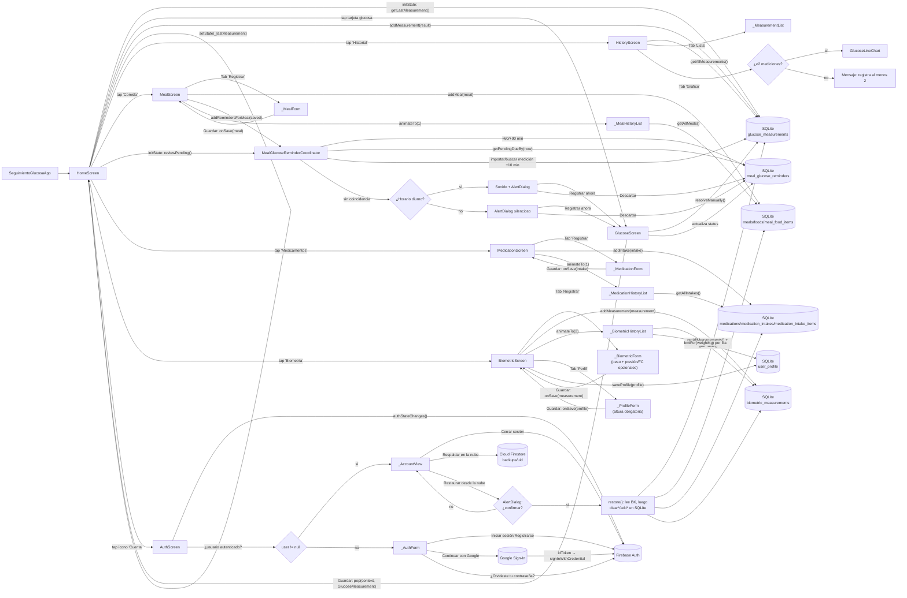

# PROJECT_GRAPH.md

Grafo de dependencias y flujo de navegación del proyecto `seguimiento_glucosa`,
generado a partir del análisis estático de `lib/` y `test/`.

> Nota (2026-10-23, sin cambios de código/grafo): avanzado el punto 10
> del checklist de producción (ficha de Google Play) con la redacción
> completa de categoría, descripción corta/larga y una guía de
> respuestas para el cuestionario de clasificación de contenido
> (IARC), todo en el nuevo `GOOGLE_PLAY_LISTING.md`. Es contenido de
> producto/tienda sin ningún cambio en `lib/` ni en `test/`. Detalle
> completo en "Historial de cambios" de `PROJECT_CONTEXT.md`, entrada
> "2026-10-23 — Redacción completa de la ficha de Google Play".
>
> Actualizado el 2026-10-23 (cambios de código menores, sin alterar
> el grafo de widgets ya documentado abajo): resueltos el disclaimer
> legal y un problema de contraste detectados al preparar las
> capturas de esa misma ficha. (1) `HomeScreen.build()` agrega, al
> final de la `Column` ya documentada más abajo, un `Text` fijo con
> el aviso "Esta app no es un dispositivo médico..." (mismo texto que
> `PRIVACY_POLICY.md`), visible siempre sin depender de que el
> usuario abra `AuthScreen` (el login es opcional). (2)
> `_buildTheme()` en `lib/main.dart` agrega `tabBarTheme:
> TabBarThemeData(labelColor: Colors.white, unselectedLabelColor:
> Colors.white70, indicatorColor: Colors.white)` al `ThemeData`
> centralizado, corrigiendo el bajo contraste por defecto de Material
> 3 en el `TabBar` de `AppBar.bottom` (pestañas
> Comida/Medicamentos/Biometría/Historial) sobre el fondo azul
> oscuro del `AppBar`; corrige las 4 pantallas a la vez sin tocar su
> código individual. Ninguno de los dos cambios altera firmas
> públicas, constructores ni el árbol de widgets ya documentado en
> la sección 2. Detalle completo en "Historial de cambios" de
> `PROJECT_CONTEXT.md`, entrada del punto 10 del checklist (commit
> `d7a8b63`).
>
> Nota (2026-10-22, sin cambios de código/grafo): **decisión de
> producto** — la versión 1.0 se publica solo en Google Play/Android;
> la validación manual en iOS/macOS (punto 8 del checklist de
> producción) y la ficha de App Store quedan **pospuestas** para una
> versión futura, no solo bloqueadas por falta de hardware Apple. El
> código multiplataforma existente (`Platform.isIOS`,
> `DarwinNotificationService`, `ios/Runner/GoogleService-Info.plist`,
> importación vía Apple Health) se conserva íntegro, sin eliminar ni
> comentar nada; solo se pospone su validación y publicación. Detalle
> completo en "Historial de cambios" de `PROJECT_CONTEXT.md`, entrada
> "2026-10-22 — Decisión: alcance de la versión 1.0 limitado a
> Android".
>
> Actualizado el 2026-10-22: flujo completo de eliminación de cuenta
> y datos desde `AuthScreen` (último bloqueante crítico de producción).
> `AuthRepository` añade `deleteAccount()`
> (`FirebaseAuthRepository`→`FirebaseAuth.currentUser.delete()`), y el
> nuevo contrato `CloudDataDeletionRepository.deleteAllCloudData()` lo
> implementan `FirestoreCloudSyncRepository` (móvil) y
> `FirestoreCloudSyncViewer` (escritorio). La UI ejecuta en orden
> nube→Auth→SQLite opcional: primero borra por lotes las cuatro
> subcolecciones `users/{uid}/...` todavía autenticado, luego la cuenta,
> y finalmente `AppDatabase.deleteAllUserData()` si el usuario conserva
> marcada esa opción; antes cancela notificaciones locales pendientes.
> Detalle completo y pruebas en "Historial de cambios" de
> `PROJECT_CONTEXT.md`, entrada "2026-10-22 — Eliminación de cuenta y
> datos desde la app".
>
> Nota (2026-10-22, sin cambios de código/grafo): resueltos los
> primeros dos bloqueantes críticos del checklist de producción
> (`applicationId`/bundle ID definitivo `cl.ogb.seguimientoglucosa.app`
> y keystore de release real). Son cambios de configuración de
> packaging/Firebase (Gradle, Xcode, `google-services.json`,
> `GoogleService-Info.plist`, `firebase_options.dart`), sin impacto en
> el grafo de dependencias de `lib/` ni en el flujo de navegación.
> Detalle completo en "Historial de cambios" de `PROJECT_CONTEXT.md`,
> entrada "2026-10-22 — Keystore de release real +
> `applicationId`/bundle ID definitivos".
>
> Nota (2026-10-22, sin cambios de código Dart/grafo de navegación):
> auditado y blindado el punto 9 del checklist (R8/minificación de
> Android). El Flutter Gradle Plugin ya habilitaba automáticamente
> `minifyEnabled`/`shrinkResources` en el build `release` sin
> configuración explícita del proyecto; se documentó ese comportamiento
> en `android/app/build.gradle.kts` y se añadieron
> `android/app/proguard-rules.pro` y
> `android/app/src/main/res/raw/keep.xml` (este último protege
> explícitamente el ícono `@mipmap/ic_launcher` usado por
> `AndroidNotificationService` del *resource shrinker*, antes protegido
> solo por coincidencia con el ícono de la app). Son cambios de
> configuración nativa de Android, sin impacto en el grafo de
> dependencias de `lib/`. Detalle completo en "Historial de cambios" de
> `PROJECT_CONTEXT.md`, entrada "2026-10-22 — R8/minificación auditada y
> blindaje del ícono de notificaciones".
>
> Nota (2026-10-22, sin cambios de código): resuelto el punto 7 del
> checklist, validando interactivamente el `app-release.apk` (el mismo
> build minificado del punto anterior) en un Honor real
> (Android 16/arm64). Sin crashes en ningún flujo: persistencia SQLite
> de los cuatro tipos de registro, gráfico de historial, login real con
> Google/Firebase Auth, sincronización automática a Firestore
> confirmada en la consola de Firebase, notificaciones locales de
> recordatorios post-comida (ícono incluido, validando en hardware real
> el blindaje `keep.xml`), y el botón "Importar desde sensor" (Health
> Connect), que respondió con el "permiso denegado" esperado en ese
> dispositivo. Resuelve en la práctica también los puntos 18, 20 y 22
> de la tabla de deuda técnica más abajo (login con Google, respaldo/
> sincronización e importación desde sensores, antes solo probados con
> `flutter build apk --debug`, ahora con una ejecución interactiva
> real). Detalle completo en "Historial de cambios" de
> `PROJECT_CONTEXT.md`, entrada "2026-10-22 — Validación manual en
> dispositivo Android físico real".
>
> Nota (2026-10-22, sin cambios de código/grafo): se evaluó y se
> descartó integrar en la app distribuida un puente no oficial
> (`HealthConnect-LibreLinkUp`) para llevar lecturas de sensores sin
> integración oficial con Health Connect (p. ej. FreeStyle Libre 2
> Plus) hacia `GlucoseImportRepository`/`HealthGlucoseImportRepository`
> (ver `lib/services/glucose_import_repository.dart` y
> `health_glucose_import_repository.dart` más abajo, que no cambiaron:
> siguen siendo una importación agnóstica de fabricante vía el plugin
> `health`). Detalle completo de la decisión y su justificación en
> "Historial de cambios" de `PROJECT_CONTEXT.md`, entrada
> "2026-10-22 — Decisión: no integrar el puente no oficial
> LibreLinkUp→Health Connect en la app distribuida".
>
> Actualizado el 2026-10-21: `MealGlucoseReminderCoordinator.reviewPending()`
> cambia su estrategia de auto-resolución. Antes exigía que una medición
> (ya existente o recién importada en bloque) estuviera dentro de ±10
> minutos de `MealGlucoseReminder.dueAt`. Ahora, si hay un sensor/CGM
> disponible, toma siempre su lectura más reciente
> (`GlucoseImportRepository.fetchLatestMeasurement()`, vía el nuevo método
> privado `_fetchLatestFromSensorSafely()`) y la usa para auto-resolver de
> inmediato todos los recordatorios vencidos de esa pasada, sin exigir
> cercanía temporal (nuevo método privado `_autoResolveWithSensor()`, que
> genera un registro de medición propio —`uuid` independiente— por cada
> recordatorio, aunque varios compartan la misma lectura del sensor). Solo
> sin sensor disponible, o si no devuelve ninguna lectura, se mantiene el
> comportamiento de respaldo ±10 minutos previo sin cambios. No hay
> cambios en la firma pública de la clase ni en
> `MealGlucoseReminderReviewResult`/`PendingMealGlucoseReminder`: es
> transparente para `HomeScreen`. Ver "Historial de cambios" de
> `PROJECT_CONTEXT.md` para el detalle completo.
>
> Cambio previo (2026-10-19): se extendió la **Fase B** a iOS: nueva
> `DarwinNotificationService` en
> `lib/services/darwin_notification_service.dart` (implementa
> `NotificationService`, mismo contrato que `AndroidNotificationService`,
> sobre `flutter_local_notifications`/`timezone`/`flutter_timezone`).
> `lib/main.dart` ganó la función privada `_createNotificationService()`
> que elige `AndroidNotificationService()`/`DarwinNotificationService()`
> según `Platform.isAndroid`/`Platform.isIOS` (`null` en otra
> plataforma), en vez de instanciar siempre
> `AndroidNotificationService()`. `MealGlucoseReminderCoordinator` y
> `HomeScreen` no cambiaron: ya dependían solo de la interfaz
> `NotificationService`. Requirió agregar `import
> flutter_local_notifications` y registrar
> `UNUserNotificationCenter.current().delegate`/
> `FlutterLocalNotificationsPlugin.setPluginRegistrantCallback` en
> `ios/Runner/AppDelegate.swift`; no se necesitó ninguna clave nueva en
> `ios/Runner/Info.plist` (las notificaciones *locales* no la
> requieren, a diferencia de *remote push*). No fue posible validar
> `flutter build ios` desde este entorno Windows (sin Mac disponible).
>
> Cambio previo (2026-08-23): se agregó la **Fase B** (solo Android)
> de los recordatorios de medición post-comida: notificaciones push
> locales reales (`NotificationService` en
> `lib/services/notification_service.dart`,
> `AndroidNotificationService` en
> `lib/services/android_notification_service.dart`, sobre
> `flutter_local_notifications`/`timezone`/`flutter_timezone`).
> `MealGlucoseReminderCoordinator` ganó el parámetro opcional
> `notificationService`: si no es `null`, `addRemindersForMeal`
> programa la notificación de cada recordatorio nuevo,
> `dismiss`/`resolveManually`/`reviewPending` (al auto-resolver)
> cancelan la correspondiente, y el nuevo método
> `rescheduleAllPending()` reprograma todas las pendientes como red de
> seguridad al iniciar la app (requirió el nuevo método
> `getAllPending()` en `MealGlucoseReminderRepository`). `HomeScreen`
> ganó el parámetro opcional `notificationService`: cuando está
> presente y `enableMealReminders` es `true`, solicita el permiso de
> notificaciones, llama a `rescheduleAllPending()`, y se suscribe a
> `NotificationService.onNotificationTapped` para volver a revisar los
> pendientes cuando el usuario toca una notificación. Requirió
> habilitar `isCoreLibraryDesugaringEnabled`/`multiDexEnabled` en
> `android/app/build.gradle.kts` y agregar permisos/`<receiver>` en
> `android/app/src/main/AndroidManifest.xml`.
>
> Cambio previo: se agregaron los recordatorios de medición
> post-comida, **Fase A** (`MealGlucoseReminder`,
> `MealGlucoseReminderRepository`/`SqliteMealGlucoseReminderRepository`
> en `lib/services/meal_glucose_reminder_repository.dart`, y
> `MealGlucoseReminderCoordinator` en
> `lib/services/meal_glucose_reminder_coordinator.dart`), que cubrió
> solo la lógica de dominio, la persistencia y la interacción in-app.
> `MealScreen` ganó el parámetro opcional `reminderCoordinator`: si no
> es `null`, cada comida guardada genera dos `MealGlucoseReminder` (60
> y 90 minutos desde `Meal.eatenAt`). `HomeScreen` ganó
> `reminderRepository` y el flag `enableMealReminders` (`false` por
> defecto, mismo patrón que `enableHealthImport`); cuando está activo,
> revisa los recordatorios vencidos en `initState` y muestra un
> `AlertDialog` secuencial por cada uno que no se resolvió solo vía
> sensor/CGM (tolerancia ±10 minutos respecto a `dueAt`), con sonido
> (`SystemSound.play`, disparado con `unawaited` para no bloquear la
> UI) si es de día (07:00–22:00) o silencioso si es de noche. La nueva
> tabla `meal_glucose_reminders` subió `AppDatabase._schemaVersion` a
> `7`. Ningún otro repositorio de datos de salud cambió: SQLite sigue
> siendo el almacenamiento principal.
>
> Cambio previo: se agregó el perfil de usuario
> (`UserProfile`/`UserProfileRepository`/`SqliteUserProfileRepository`,
> en `lib/models/user_profile.dart` y
> `lib/services/user_profile_repository.dart`) y el cálculo de IMC
> (`UserProfile.bmiFor` + `bmiCategoryFor`) en el módulo de Biometría.
> `BiometricScreen` pasó de 2 a 3 pestañas: **Registrar**, **Perfil**
> (nueva, con altura obligatoria y fecha de nacimiento/sexo
> biológico/nombre a mostrar opcionales) e **Historial** (ahora muestra
> el IMC de cada peso cuando el perfil tiene altura guardada).
> `HomeScreen` ganó el parámetro `profileRepository` (mismo patrón de
> inyección que `biometricRepository`, sin flag `enable*` porque no
> depende de ningún plugin externo: es solo SQLite local). El perfil se
> persiste en la nueva tabla `user_profile` (versión de esquema 6 de
> `AppDatabase`), con patrón "singleton row" (`id = 1` fijo) ya que la
> app no tiene soporte multiusuario. Ningún otro repositorio de datos
> de salud cambió: SQLite sigue siendo el almacenamiento principal.
>
> Cambio previo: se agregó la importación manual de
> glucosa desde sensores/CGM (`GlucoseImportRepository`/
> `HealthGlucoseImportRepository`, vía el plugin `health` sobre Google
> Health Connect/Apple Health), **opcional** y de **solo lectura**
> (nunca escribe en la plataforma de salud). `HistoryScreen` ganó un
> ícono "Importar desde sensor" en el `AppBar`, visible solo si se
> inyecta un `importRepository`; deduplica por fecha/hora + valor, ya
> que no existe una clave estable entre el historial local (IDs
> autoincrementales de SQLite) y la plataforma de salud. `HomeScreen`
> ganó un flag `enableHealthImport` (`false` por defecto, `true` solo
> desde `main.dart`), mismo patrón que `enableCloudBackup`, para que
> `HealthGlucoseImportRepository` no se construya automáticamente en
> los widget tests. Requirió subir `minSdk` de Android a 26
> (exigencia del plugin `health`). Ningún otro repositorio de datos de
> salud ni `AppDatabase` cambiaron: SQLite sigue siendo el
> almacenamiento principal.
>
> Cambio previo: se agregó respaldo/restauración manual en la nube
> (`BackupRepository`/`FirestoreBackupRepository`, sobre Cloud
> Firestore), **opcional** y disponible solo con sesión iniciada.
> `AuthScreen` → `_AccountView` ganó los botones "Respaldar en la
> nube" y "Restaurar desde la nube" (este último con un `AlertDialog`
> de confirmación, ya que **reemplaza** todos los datos locales en
> lugar de fusionarlos — no hay clave estable entre dispositivos para
> fusionar sin duplicados). `HomeScreen` ganó un flag
> `enableCloudBackup` (`false` por defecto, `true` solo desde
> `main.dart`) para que `FirestoreBackupRepository` no se construya
> automáticamente en los widget tests. Ningún repositorio de datos de
> salud (`GlucoseRepository`, `MealRepository`,
> `MedicationRepository`, `BiometricRepository`) ni `AppDatabase`
> cambiaron: SQLite sigue siendo el almacenamiento principal;
> Firestore solo guarda una copia de respaldo bajo demanda explícita.
>
> Cambio previo (mismo día): se agregó autenticación de usuarios
> (`AppUser`, `AuthRepository`/`FirebaseAuthRepository`, pantalla
> `AuthScreen`), **opcional**: no bloquea el resto de la app. Soporta
> correo/contraseña y Google (`google_sign_in` 7.x +
> `GoogleAuthProvider.credential` + `signInWithCredential`).
> `HomeScreen` ganó un ícono "Cuenta" en el `AppBar` que navega a
> `AuthScreen`; `main.dart` inicializa `GoogleSignIn` con el Web Client
> ID del proyecto antes de `runApp`.
>
> Cambio previo (mismo día): se integró Firebase (proyecto
> `seguimiento-glucosa`) como base de preparación para pasos futuros del
> roadmap. `lib/main.dart` inicializa `Firebase.initializeApp()` antes
> de `runApp`, usando las opciones generadas por `flutterfire configure`
> en `lib/firebase_options.dart`.
> `ios/Runner/GoogleService-Info.plist` (no generado por
> `flutterfire configure` al correr en Windows) se completó con
> `firebase apps:sdkconfig IOS` y se enlazó manualmente en
> `ios/Runner.xcodeproj/project.pbxproj`.
>
> Cambio previo (mismo día): se amplió el módulo de Biometría
> (`BiometricMeasurement`, `BiometricRepository`/
> `SqliteBiometricRepository`, pantalla `BiometricScreen` con pestañas
> **Registrar**/**Historial**) con presión arterial y frecuencia
> cardíaca opcionales, además del peso corporal obligatorio ya existente
> (el IMC queda pendiente hasta que exista un perfil de usuario con
> altura). El módulo de Biometría se suma al módulo de Medicamentos
> (`Medication`/`MedicationIntake`/`MedicationIntakeItem`,
> `MedicationRepository`/`SqliteMedicationRepository`, pantalla
> `MedicationScreen`) y al módulo de Comidas (`Food`/`Meal`/
> `MealFoodItem`, `MealRepository`/`SqliteMealRepository`, pantalla
> `MealScreen`). El gestor compartido de base de datos `AppDatabase`
> administra 8 tablas SQLite (`glucose_measurements`, `foods`, `meals`,
> `meal_food_items`, `medications`, `medication_intakes`,
> `medication_intake_items`, `biometric_measurements`) con migraciones
> versionadas (`_schemaVersion = 5`; la versión 5 agregó las columnas
> `systolic_pressure`, `diastolic_pressure` y `heart_rate_bpm` a
> `biometric_measurements`).

---

## 1. Grafo de dependencias entre archivos (imports)

```text
lib/main.dart
 └─ imports: dart:io
 └─ imports: package:firebase_core/firebase_core.dart
 └─ imports: package:flutter/material.dart
 └─ imports: lib/firebase_options.dart
 │    └─ imports: package:firebase_core/firebase_core.dart
 │    └─ imports: package:flutter/foundation.dart
 └─ imports: lib/services/android_notification_service.dart
 │    └─ imports: dart:async
 │    └─ imports: package:flutter_local_notifications/flutter_local_notifications.dart
 │    └─ imports: package:flutter_timezone/flutter_timezone.dart
 │    └─ imports: package:timezone/data/latest_all.dart
 │    └─ imports: package:timezone/timezone.dart
 │    └─ imports: lib/services/notification_service.dart
 └─ imports: lib/services/darwin_notification_service.dart
 │    └─ imports: dart:async
 │    └─ imports: package:flutter_local_notifications/flutter_local_notifications.dart
 │    └─ imports: package:flutter_timezone/flutter_timezone.dart
 │    └─ imports: package:timezone/data/latest_all.dart
 │    └─ imports: package:timezone/timezone.dart
 │    └─ imports: lib/services/notification_service.dart
 └─ imports: lib/services/firebase_auth_repository.dart
 │    └─ imports: package:firebase_auth/firebase_auth.dart
 │    └─ imports: package:google_sign_in/google_sign_in.dart
 │    └─ imports: lib/models/app_user.dart
 │    └─ imports: lib/services/auth_repository.dart
 │         └─ imports: lib/models/app_user.dart
 └─ imports: lib/services/notification_service.dart
 │    (sin imports externos: solo tipos propios, interfaz abstracta)
 └─ imports: lib/screens/home_screen.dart
      └─ imports: dart:async
      └─ imports: package:flutter/material.dart
      └─ imports: package:flutter/services.dart
      └─ imports: lib/models/glucose_measurement.dart
      └─ imports: lib/models/meal_glucose_reminder.dart
      └─ imports: lib/services/app_database.dart
      └─ imports: lib/services/auth_repository.dart
      └─ imports: lib/services/firebase_auth_repository.dart
      └─ imports: lib/services/backup_repository.dart
      └─ imports: lib/services/firestore_backup_repository.dart
      │    └─ imports: package:cloud_firestore/cloud_firestore.dart
      │    └─ imports: package:firebase_auth/firebase_auth.dart
      │    └─ imports: lib/models/biometric_measurement.dart
      │    └─ imports: lib/models/food.dart
      │    └─ imports: lib/models/glucose_measurement.dart
      │    └─ imports: lib/models/meal.dart
      │    └─ imports: lib/models/medication.dart
      │    └─ imports: lib/models/medication_intake.dart
      │    └─ imports: lib/services/backup_repository.dart
      │    └─ imports: lib/services/biometric_repository.dart
      │    └─ imports: lib/services/glucose_repository.dart
      │    └─ imports: lib/services/meal_repository.dart
      │    └─ imports: lib/services/medication_repository.dart
      │    └─ imports: package:path/path.dart
      │    └─ imports: package:sqflite/sqflite.dart
      └─ imports: lib/services/glucose_repository.dart
      │    └─ imports: package:sqflite/sqflite.dart
      │    └─ imports: lib/models/glucose_measurement.dart
      │    └─ imports: lib/services/app_database.dart
      └─ imports: lib/services/meal_repository.dart
      │    └─ imports: package:sqflite/sqflite.dart
      │    └─ imports: lib/models/food.dart
      │    └─ imports: lib/models/meal.dart
      │    │    └─ imports: lib/models/food.dart
      │    └─ imports: lib/services/app_database.dart
      └─ imports: lib/services/medication_repository.dart
      │    └─ imports: package:sqflite/sqflite.dart
      │    └─ imports: lib/models/medication.dart
      │    └─ imports: lib/models/medication_intake.dart
      │    │    └─ imports: lib/models/medication.dart
      │    └─ imports: lib/services/app_database.dart
      └─ imports: lib/services/biometric_repository.dart
      │    └─ imports: package:sqflite/sqflite.dart
      │    └─ imports: lib/models/biometric_measurement.dart
      │    └─ imports: lib/services/app_database.dart
      └─ imports: lib/services/glucose_import_repository.dart
      │    (sin imports externos: solo tipos propios y HealthImportException)
      └─ imports: lib/services/health_glucose_import_repository.dart
      │    └─ imports: package:health/health.dart
      │    └─ imports: lib/models/glucose_measurement.dart
      │    └─ imports: lib/services/glucose_import_repository.dart
      │    └─ imports: lib/services/glucose_repository.dart
      └─ imports: lib/services/user_profile_repository.dart
      │    └─ imports: package:sqflite/sqflite.dart
      │    └─ imports: lib/models/user_profile.dart
      │    └─ imports: lib/services/app_database.dart
      └─ imports: lib/services/meal_glucose_reminder_repository.dart
      │    └─ imports: package:sqflite/sqflite.dart
      │    └─ imports: lib/models/meal_glucose_reminder.dart
      │    └─ imports: lib/services/app_database.dart
      └─ imports: lib/services/meal_glucose_reminder_coordinator.dart
      │    └─ imports: lib/models/glucose_measurement.dart
      │    └─ imports: lib/models/meal.dart
      │    └─ imports: lib/models/meal_glucose_reminder.dart
      │    └─ imports: lib/services/glucose_import_repository.dart
      │    └─ imports: lib/services/glucose_repository.dart
      │    └─ imports: lib/services/meal_glucose_reminder_repository.dart
      └─ imports: lib/screens/glucose_screen.dart
      │    └─ imports: package:flutter/material.dart
      │    └─ imports: lib/models/glucose_measurement.dart
      └─ imports: lib/screens/history_screen.dart
      │    └─ imports: package:flutter/material.dart
      │    └─ imports: package:intl/intl.dart
      │    └─ imports: lib/models/glucose_measurement.dart
      │    └─ imports: lib/services/glucose_import_repository.dart
      │    └─ imports: lib/services/glucose_repository.dart
      │    └─ imports: lib/widgets/glucose_line_chart.dart
      │         └─ imports: package:fl_chart/fl_chart.dart
      │         └─ imports: package:flutter/material.dart
      │         └─ imports: package:intl/intl.dart
      │         └─ imports: lib/models/glucose_measurement.dart
      └─ imports: lib/screens/meal_screen.dart
      │    └─ imports: package:flutter/material.dart
      │    └─ imports: package:intl/intl.dart
      │    └─ imports: lib/models/food.dart
      │    └─ imports: lib/models/meal.dart
      │    └─ imports: lib/services/meal_glucose_reminder_coordinator.dart
      │    └─ imports: lib/services/meal_repository.dart
      └─ imports: lib/screens/medication_screen.dart
      │    └─ imports: package:flutter/material.dart
      │    └─ imports: package:intl/intl.dart
      │    └─ imports: lib/models/medication.dart
      │    └─ imports: lib/models/medication_intake.dart
      │    └─ imports: lib/services/medication_repository.dart
      └─ imports: lib/screens/biometric_screen.dart
      │    └─ imports: package:flutter/material.dart
      │    └─ imports: package:intl/intl.dart
      │    └─ imports: lib/models/biometric_measurement.dart
      │    └─ imports: lib/models/user_profile.dart
      │    └─ imports: lib/services/biometric_repository.dart
      │    └─ imports: lib/services/user_profile_repository.dart
      └─ imports: lib/screens/auth_screen.dart
           └─ imports: package:flutter/material.dart
           └─ imports: lib/models/app_user.dart
           └─ imports: lib/services/auth_repository.dart
           └─ imports: lib/services/backup_repository.dart

test/widget_test.dart
 └─ imports: dart:async
 └─ imports: package:fl_chart/fl_chart.dart
 └─ imports: package:flutter/material.dart
 └─ imports: package:flutter_test/flutter_test.dart
 └─ imports: package:seguimiento_glucosa/models/app_user.dart
 └─ imports: package:seguimiento_glucosa/models/biometric_measurement.dart
 └─ imports: package:seguimiento_glucosa/models/food.dart
 └─ imports: package:seguimiento_glucosa/models/glucose_measurement.dart
 └─ imports: package:seguimiento_glucosa/models/meal.dart
 └─ imports: package:seguimiento_glucosa/models/meal_glucose_reminder.dart
 └─ imports: package:seguimiento_glucosa/models/medication.dart
 └─ imports: package:seguimiento_glucosa/models/medication_intake.dart
 └─ imports: package:seguimiento_glucosa/models/user_profile.dart
 └─ imports: package:seguimiento_glucosa/screens/home_screen.dart
 └─ imports: package:seguimiento_glucosa/services/auth_repository.dart
 └─ imports: package:seguimiento_glucosa/services/backup_repository.dart
 └─ imports: package:seguimiento_glucosa/services/biometric_repository.dart
 └─ imports: package:seguimiento_glucosa/services/glucose_import_repository.dart
 └─ imports: package:seguimiento_glucosa/services/glucose_repository.dart
 └─ imports: package:seguimiento_glucosa/services/meal_glucose_reminder_repository.dart
 └─ imports: package:seguimiento_glucosa/services/meal_repository.dart
 └─ imports: package:seguimiento_glucosa/services/medication_repository.dart
 └─ imports: package:seguimiento_glucosa/services/user_profile_repository.dart

test/models/user_profile_test.dart
 └─ imports: package:flutter_test/flutter_test.dart
 └─ imports: package:seguimiento_glucosa/models/user_profile.dart

test/services/glucose_repository_test.dart
 └─ imports: package:flutter_test/flutter_test.dart
 └─ imports: package:sqflite_common_ffi/sqflite_ffi.dart
 └─ imports: package:seguimiento_glucosa/models/glucose_measurement.dart
 └─ imports: package:seguimiento_glucosa/services/glucose_repository.dart

test/services/meal_repository_test.dart
 └─ imports: package:flutter_test/flutter_test.dart
 └─ imports: package:sqflite_common_ffi/sqflite_ffi.dart
 └─ imports: package:seguimiento_glucosa/models/food.dart
 └─ imports: package:seguimiento_glucosa/models/meal.dart
 └─ imports: package:seguimiento_glucosa/services/meal_repository.dart

test/services/medication_repository_test.dart
 └─ imports: package:flutter_test/flutter_test.dart
 └─ imports: package:sqflite_common_ffi/sqflite_ffi.dart
 └─ imports: package:seguimiento_glucosa/models/medication.dart
 └─ imports: package:seguimiento_glucosa/models/medication_intake.dart
 └─ imports: package:seguimiento_glucosa/services/medication_repository.dart

test/services/biometric_repository_test.dart
 └─ imports: package:flutter_test/flutter_test.dart
 └─ imports: package:sqflite_common_ffi/sqflite_ffi.dart
 └─ imports: package:seguimiento_glucosa/models/biometric_measurement.dart
 └─ imports: package:seguimiento_glucosa/services/biometric_repository.dart

test/services/user_profile_repository_test.dart
 └─ imports: package:flutter_test/flutter_test.dart
 └─ imports: package:sqflite_common_ffi/sqflite_ffi.dart
 └─ imports: package:seguimiento_glucosa/models/user_profile.dart
 └─ imports: package:seguimiento_glucosa/services/user_profile_repository.dart

test/services/meal_glucose_reminder_repository_test.dart
 └─ imports: package:flutter_test/flutter_test.dart
 └─ imports: package:sqflite_common_ffi/sqflite_ffi.dart
 └─ imports: package:seguimiento_glucosa/models/food.dart
 └─ imports: package:seguimiento_glucosa/models/meal.dart
 └─ imports: package:seguimiento_glucosa/models/meal_glucose_reminder.dart
 └─ imports: package:seguimiento_glucosa/services/app_database.dart
 └─ imports: package:seguimiento_glucosa/services/meal_glucose_reminder_repository.dart
 └─ imports: package:seguimiento_glucosa/services/meal_repository.dart

test/services/meal_glucose_reminder_coordinator_test.dart
 └─ imports: package:flutter_test/flutter_test.dart
 └─ imports: package:seguimiento_glucosa/models/glucose_measurement.dart
 └─ imports: package:seguimiento_glucosa/models/meal.dart
 └─ imports: package:seguimiento_glucosa/models/meal_glucose_reminder.dart
 └─ imports: package:seguimiento_glucosa/services/glucose_import_repository.dart
 └─ imports: package:seguimiento_glucosa/services/glucose_repository.dart
 └─ imports: package:seguimiento_glucosa/services/meal_glucose_reminder_coordinator.dart
 └─ imports: package:seguimiento_glucosa/services/meal_glucose_reminder_repository.dart
```

### Representación Mermaid

```mermaid
graph TD
    main["lib/main.dart"] --> firebaseOpts["lib/firebase_options.dart"]
    main --> authRepoImpl["lib/services/firebase_auth_repository.dart"]
    main --> home["lib/screens/home_screen.dart"]
    home --> glucose["lib/screens/glucose_screen.dart"]
    home --> model["lib/models/glucose_measurement.dart"]
    home --> reminderModel["lib/models/meal_glucose_reminder.dart"]
    home --> db["lib/services/app_database.dart"]
    home --> repo["lib/services/glucose_repository.dart"]
    home --> mealRepo["lib/services/meal_repository.dart"]
    home --> medRepo["lib/services/medication_repository.dart"]
    home --> bioRepo["lib/services/biometric_repository.dart"]
    home --> profileRepo["lib/services/user_profile_repository.dart"]
    home --> reminderRepo["lib/services/meal_glucose_reminder_repository.dart"]
    home --> reminderCoord["lib/services/meal_glucose_reminder_coordinator.dart"]
    home --> importRepo["lib/services/glucose_import_repository.dart"]
    home --> authRepo["lib/services/auth_repository.dart"]
    home --> authRepoImpl
    home --> backupRepo["lib/services/backup_repository.dart"]
    home --> backupRepoImpl["lib/services/firestore_backup_repository.dart"]
    home --> history["lib/screens/history_screen.dart"]
    home --> mealScreen["lib/screens/meal_screen.dart"]
    home --> medScreen["lib/screens/medication_screen.dart"]
    home --> bioScreen["lib/screens/biometric_screen.dart"]
    home --> authScreen["lib/screens/auth_screen.dart"]
    glucose --> model
    repo --> model
    repo --> db
    mealRepo --> db
    mealRepo --> food["lib/models/food.dart"]
    mealRepo --> meal["lib/models/meal.dart"]
    meal --> food
    medRepo --> db
    medRepo --> medication["lib/models/medication.dart"]
    medRepo --> intake["lib/models/medication_intake.dart"]
    intake --> medication
    bioRepo --> db
    bioRepo --> bioModel["lib/models/biometric_measurement.dart"]
    profileRepo --> db
    profileRepo --> profileModel["lib/models/user_profile.dart"]
    reminderRepo --> db
    reminderRepo --> reminderModel
    reminderCoord --> model
    reminderCoord --> meal
    reminderCoord --> reminderModel
    reminderCoord --> reminderRepo
    reminderCoord --> repo
    reminderCoord --> importRepo
    mealScreen --> reminderCoord
    history --> model
    history --> repo
    history --> chart["lib/widgets/glucose_line_chart.dart"]
    chart --> model
    mealScreen --> food
    mealScreen --> meal
    mealScreen --> mealRepo
    medScreen --> medication
    medScreen --> intake
    medScreen --> medRepo
    bioScreen --> bioModel
    bioScreen --> bioRepo
    bioScreen --> profileModel
    bioScreen --> profileRepo
    authRepoImpl --> authUser["lib/models/app_user.dart"]
    authRepoImpl --> authRepo
    authRepo --> authUser
    authScreen --> authUser
    authScreen --> authRepo
    authScreen --> backupRepo
    backupRepoImpl --> backupRepo
    backupRepoImpl --> model
    backupRepoImpl --> food
    backupRepoImpl --> meal
    backupRepoImpl --> medication
    backupRepoImpl --> intake
    backupRepoImpl --> bioModel
    backupRepoImpl --> repo
    backupRepoImpl --> mealRepo
    backupRepoImpl --> medRepo
    backupRepoImpl --> bioRepo

    widget_test["test/widget_test.dart"] --> model
    widget_test --> food
    widget_test --> meal
    widget_test --> medication
    widget_test --> intake
    widget_test --> bioModel
    widget_test --> profileModel
    widget_test --> home
    widget_test --> repo
    widget_test --> mealRepo
    widget_test --> medRepo
    widget_test --> bioRepo
    widget_test --> profileRepo
    widget_test --> reminderModel
    widget_test --> reminderRepo
    widget_test --> authRepo
    widget_test --> backupRepo
    repo_test["test/services/glucose_repository_test.dart"] --> model
    repo_test --> repo
    meal_repo_test["test/services/meal_repository_test.dart"] --> food
    meal_repo_test --> meal
    meal_repo_test --> mealRepo
    bio_repo_test["test/services/biometric_repository_test.dart"] --> bioModel
    bio_repo_test --> bioRepo
    med_repo_test["test/services/medication_repository_test.dart"] --> medication
    med_repo_test --> intake
    med_repo_test --> medRepo
    profile_test["test/models/user_profile_test.dart"] --> profileModel
    profile_repo_test["test/services/user_profile_repository_test.dart"] --> profileModel
    profile_repo_test --> profileRepo
    reminder_repo_test["test/services/meal_glucose_reminder_repository_test.dart"] --> food
    reminder_repo_test --> meal
    reminder_repo_test --> reminderModel
    reminder_repo_test --> db
    reminder_repo_test --> reminderRepo
    reminder_repo_test --> mealRepo
    reminder_coord_test["test/services/meal_glucose_reminder_coordinator_test.dart"] --> model
    reminder_coord_test --> meal
    reminder_coord_test --> reminderModel
    reminder_coord_test --> importRepo
    reminder_coord_test --> repo
    reminder_coord_test --> reminderCoord
    reminder_coord_test --> reminderRepo

    pkg_material["package:flutter/material.dart"]
    pkg_test["package:flutter_test/flutter_test.dart"]
    pkg_intl["package:intl/intl.dart"]
    pkg_sqflite["package:sqflite/sqflite.dart"]
    pkg_sqflite_ffi["package:sqflite_common_ffi/sqflite_ffi.dart"]
    pkg_path["package:path/path.dart"]
    pkg_fl_chart["package:fl_chart/fl_chart.dart"]

    main --> pkg_material
    home --> pkg_material
    glucose --> pkg_material
    history --> pkg_material
    history --> pkg_intl
    mealScreen --> pkg_material
    mealScreen --> pkg_intl
    medScreen --> pkg_material
    medScreen --> pkg_intl
    bioScreen --> pkg_material
    bioScreen --> pkg_intl
    chart --> pkg_material
    chart --> pkg_intl
    chart --> pkg_fl_chart
    db --> pkg_sqflite
    db --> pkg_path
    repo --> pkg_sqflite
    mealRepo --> pkg_sqflite
    medRepo --> pkg_sqflite
    bioRepo --> pkg_sqflite
    profileRepo --> pkg_sqflite
    reminderRepo --> pkg_sqflite
    widget_test --> pkg_material
    widget_test --> pkg_test
    widget_test --> pkg_fl_chart
    repo_test --> pkg_test
    repo_test --> pkg_sqflite_ffi
    meal_repo_test --> pkg_test
    meal_repo_test --> pkg_sqflite_ffi
    med_repo_test --> pkg_test
    med_repo_test --> pkg_sqflite_ffi
    bio_repo_test --> pkg_test
    bio_repo_test --> pkg_sqflite_ffi
    profile_test --> pkg_test
    profile_repo_test --> pkg_test
    profile_repo_test --> pkg_sqflite_ffi
    reminder_repo_test --> pkg_test
    reminder_repo_test --> pkg_sqflite_ffi
    reminder_coord_test --> pkg_test
```



`lib/models/glucose_measurement.dart`, `lib/models/food.dart`,
`lib/models/meal.dart`, `lib/models/meal_glucose_reminder.dart`,
`lib/models/medication.dart`,
`lib/models/medication_intake.dart`,
`lib/models/biometric_measurement.dart`, `lib/models/user_profile.dart`
y `lib/models/app_user.dart` no dependen de Flutter: son módulos de
Dart puro, lo que facilita probarlos de forma aislada sin
`flutter_test` (ver `test/models/user_profile_test.dart`, que prueba
`UserProfile.bmiFor`/`bmiCategoryFor` sin `flutter_test` ni `sqflite`).
`lib/services/app_database.dart`,
`lib/services/glucose_repository.dart`,
`lib/services/meal_repository.dart`,
`lib/services/meal_glucose_reminder_repository.dart`,
`lib/services/meal_glucose_reminder_coordinator.dart`,
`lib/services/medication_repository.dart`,
`lib/services/biometric_repository.dart` y
`lib/services/user_profile_repository.dart` tampoco dependen de Flutter.
Las implementaciones SQLite se pueden probar directamente con
`sqflite_common_ffi`; el coordinador se prueba con fakes en memoria, sin
plugins ni base de datos real.
`lib/services/auth_repository.dart`
(la interfaz) tampoco depende de Flutter ni de Firebase, solo de
`lib/models/app_user.dart`, lo que permite el `_FakeAuthRepository` de
`test/widget_test.dart` sin tocar `firebase_auth`/`google_sign_in`.
`lib/services/backup_repository.dart` (la interfaz) tampoco depende de
Flutter ni de Firebase, solo de los modelos de dominio, lo que permite
el `_FakeBackupRepository` de `test/widget_test.dart` sin tocar
`cloud_firestore`. `fl_chart` es la única dependencia externa que no es
`flutter`/`intl`/`sqflite`/`path`/`firebase_*`/`google_sign_in`/`cloud_firestore`,
y es 100% Dart puro (sin plugins nativos). `firebase_core`,
`firebase_auth`, `google_sign_in` y `cloud_firestore` son plugins con
código nativo (Android/iOS), usados solo desde `lib/main.dart`,
`lib/services/firebase_auth_repository.dart` y
`lib/services/firestore_backup_repository.dart`; ningún modelo,
repositorio de datos de salud ni pantalla de dominio
(Glucosa/Comida/Medicamentos/Biometría/Historial) depende de ellos, por
lo que no afectan la testabilidad de esa lógica existente. `HomeScreen`
solo construye `FirestoreBackupRepository` cuando `enableCloudBackup`
es `true` (por defecto `false`, activado únicamente desde `main.dart`),
protegiendo también los widget tests de autenticación de tocar
Firestore real.

---

## 2. Grafo de clases y widgets

```text
main() (Future<void>, async)                 [lib/main.dart]
 ├─ WidgetsFlutterBinding.ensureInitialized()
 ├─ await Firebase.initializeApp(options: DefaultFirebaseOptions.currentPlatform)
 ├─ authRepository = FirebaseAuthRepository()
 ├─ await authRepository.initializeGoogleSignIn(serverClientId: _googleSignInServerClientId)
 └─ runApp(SeguimientoGlucosaApp(authRepository: authRepository))

SeguimientoGlucosaApp (StatelessWidget)      [lib/main.dart]
 └─ constructor({authRepository})    # FirebaseAuthRepository? ya inicializado
 └─ build() → MaterialApp
      └─ home: HomeScreen(authRepository: authRepository,
            enableCloudBackup: true, enableHealthImport: true,
            enableMealReminders: true,
            notificationService: notificationService)
            # SeguimientoGlucosaApp ahora también recibe
            # notificationService; main() usa _createNotificationService(),
            # que inyecta AndroidNotificationService() o
            # DarwinNotificationService() según Platform.isAndroid/isIOS

HomeScreen (StatefulWidget)                  [lib/screens/home_screen.dart]
 └─ constructor({repository, mealRepository, medicationRepository,
      biometricRepository, profileRepository, authRepository,
      backupRepository, enableCloudBackup = false, importRepository,
      enableHealthImport = false, reminderRepository,
      enableMealReminders = false, notificationService})
 └─ createState() → _HomeScreenState
      ├─ _sharedDatabase: AppDatabase    # late final; solo se construye si se necesita
      ├─ _repository: GlucoseRepository = widget.repository ?? SqliteGlucoseRepository.withDatabase(_sharedDatabase)
      ├─ _mealRepository: MealRepository = widget.mealRepository ?? SqliteMealRepository.withDatabase(_sharedDatabase)
      ├─ _medicationRepository: MedicationRepository = widget.medicationRepository ?? SqliteMedicationRepository.withDatabase(_sharedDatabase)
      ├─ _biometricRepository: BiometricRepository = widget.biometricRepository ?? SqliteBiometricRepository.withDatabase(_sharedDatabase)
      ├─ _profileRepository: UserProfileRepository = widget.profileRepository ?? SqliteUserProfileRepository.withDatabase(_sharedDatabase)
      ├─ _authRepository: AuthRepository = widget.authRepository ?? FirebaseAuthRepository()
      ├─ _backupRepository: BackupRepository? = widget.backupRepository ??
      │     (enableCloudBackup ? FirestoreBackupRepository(...) : null)
      │     # NO usa `??` con una implementación real incondicional (a diferencia
      │     # de los demás repos): requiere `enableCloudBackup=true` explícito,
      │     # para no tocar Firestore real en los widget tests por defecto
      ├─ _importRepository: GlucoseImportRepository? = widget.importRepository ??
      │     (enableHealthImport ? HealthGlucoseImportRepository(glucoseRepository: _repository) : null)
      │     # mismo patrón que _backupRepository: requiere `enableHealthImport=true`
      │     # explícito, para no tocar el plugin `health` real en los widget tests
      ├─ _reminderRepository: MealGlucoseReminderRepository? =
      │     widget.reminderRepository ?? (enableMealReminders
      │       ? SqliteMealGlucoseReminderRepository.withDatabase(_sharedDatabase)
      │       : null)
      ├─ _reminderCoordinator: MealGlucoseReminderCoordinator =
      │     MealGlucoseReminderCoordinator(
      │       reminderRepository: _reminderRepository, glucoseRepository: _repository,
      │       importRepository: _importRepository,
      │       notificationService: widget.notificationService)   # Fase B
      ├─ _lastMeasurement: GlucoseMeasurement?
      ├─ _isLoading: bool
      ├─ _notificationTapSubscription: StreamSubscription<void>?    # Fase B
      ├─ initState() → _loadLastMeasurement()
      │     + si enableMealReminders: _reviewPendingReminders() +
      │       _setUpNotificationTapHandling()
      │     → await _repository.getLastMeasurement() → setState(_lastMeasurement, _isLoading = false)
      ├─ dispose() → _notificationTapSubscription?.cancel()    # Fase B
      ├─ _setUpNotificationTapHandling()    # Fase B, no-op si notificationService == null
      │     → notificationService.requestPermission()
      │        .then((_) => coordinator.rescheduleAllPending())
      │     → _notificationTapSubscription =
      │         notificationService.onNotificationTapped.listen(
      │           (_) => _reviewPendingReminders())
      ├─ _reviewPendingReminders() → coordinator.reviewPending()
      │     → por cada pendiente: sonido de día + AlertDialog secuencial
      │     → "Registrar ahora": GlucoseScreen → coordinator.resolveManually()
      │     → "Descartar"/cerrar: coordinator.dismiss()
      ├─ _openGlucoseScreen() → await Navigator.push<GlucoseMeasurement>
      │     → al recibir resultado no nulo:
      │           await _repository.addMeasurement(result)
      │           → setState(_lastMeasurement = saved)
      ├─ _openHistoryScreen() → Navigator.push(HistoryScreen(repository: _repository, importRepository: _importRepository))
      ├─ _openMealScreen() → Navigator.push(MealScreen(repository: _mealRepository,
      │     reminderCoordinator: _reminderCoordinator))
      ├─ _openMedicationScreen() → Navigator.push(MedicationScreen(repository: _medicationRepository))
      ├─ _openBiometricScreen() → Navigator.push(BiometricScreen(repository: _biometricRepository, profileRepository: _profileRepository))
      ├─ _openAuthScreen() → Navigator.push(AuthScreen(repository: _authRepository, backupRepository: _backupRepository))
      └─ build() → Scaffold
           ├─ AppBar(actions: [IconButton(Icons.account_circle_outlined, tooltip: 'Cuenta', onPressed: _openAuthScreen)])
           └─ Column
                ├─ _GlucoseCard(measurement: _lastMeasurement, isLoading: _isLoading, onTap: _openGlucoseScreen)
                ├─ MenuButton(icon: restaurant,    title: 'Comida', onTap: _openMealScreen)
                ├─ MenuButton(icon: medication,    title: 'Medicamentos', onTap: _openMedicationScreen)
                ├─ MenuButton(icon: favorite,      title: 'Biometría', onTap: _openBiometricScreen)
                ├─ MenuButton(icon: show_chart,    title: 'Historial', onTap: _openHistoryScreen)
                └─ Text('Esta app no es un dispositivo médico...')
                      # aviso legal fijo (punto 10 del checklist, ficha de Google
                      # Play), siempre visible, sin depender de AuthScreen (login
                      # opcional); mismo texto que PRIVACY_POLICY.md

_GlucoseCard (StatelessWidget, privado)      [lib/screens/home_screen.dart]
 └─ build() → Card
      ├─ si isLoading → CircularProgressIndicator
      ├─ si measurement == null → '-- mg/dL'
      └─ si measurement != null → '{value} mg/dL' + moment.label

MenuButton (StatelessWidget)                 [lib/screens/home_screen.dart]
 └─ constructor({icon, title, onTap})    # onTap opcional: null en módulos pendientes
 └─ build() → Card(ListTile(icon, title, trailing: arrow, onTap))

GlucoseRepository (interfaz abstracta)       [lib/services/glucose_repository.dart]
 ├─ getLastMeasurement() → Future<GlucoseMeasurement?>
 ├─ getAllMeasurements() → Future<List<GlucoseMeasurement>>   # más reciente → más antigua
 ├─ addMeasurement(GlucoseMeasurement) → Future<GlucoseMeasurement>   # asigna id
 └─ clearMeasurements() → Future<void>

SqliteGlucoseRepository (implements GlucoseRepository)  [lib/services/glucose_repository.dart]
 ├─ constructor({factory, databasePath, singleInstance})  # inyectables para tests (sqflite_common_ffi)
 ├─ tabla `glucose_measurements` (id, value, moment, measured_at, comment)
 ├─ _db: Future<Database>    # abre/reutiliza la conexión de forma perezosa
 └─ _fromRow / _toRow         # mapeo fila SQLite ↔ GlucoseMeasurement

HistoryScreen (StatefulWidget)               [lib/screens/history_screen.dart]
 └─ constructor({required repository, importRepository})
 └─ createState() → _HistoryScreenState
      ├─ _measurementsFuture = repository.getAllMeasurements()   # una sola carga
      ├─ _isImporting: bool
      ├─ _importFromHealth() → async, solo si widget.importRepository != null
      │     ├─ await importRepository.isAvailable() → si false: mensaje "no disponible"
      │     ├─ await importRepository.requestPermission() → si false: "permiso denegado"
      │     ├─ await importRepository.importMeasurements(since: ahora - 30 días)
      │     │     → si > 0: setState(_measurementsFuture = repository.getAllMeasurements())
      │     ├─ catch HealthImportException → mensaje legible
      │     └─ ScaffoldMessenger.showSnackBar(mensaje de resultado)
      └─ build() → DefaultTabController(length: 2)
           └─ Scaffold
                ├─ AppBar('Historial') + TabBar(['Lista', 'Gráfico'])
                │     └─ actions: [IconButton(Icons.sync, tooltip: 'Importar desde sensor', onPressed: _importFromHealth)]
                │           # solo si widget.importRepository != null
                └─ FutureBuilder<List<GlucoseMeasurement>>
                     ├─ cargando → CircularProgressIndicator
                     ├─ vacío → Text('Todavía no hay mediciones registradas.')
                     └─ con datos → TabBarView
                          ├─ _MeasurementList(measurements)
                          └─ _MeasurementChart(measurements)

_MeasurementList (StatelessWidget, privado)  [lib/screens/history_screen.dart]
 └─ build() → ListView.separated(_MeasurementTile por cada medición)

_MeasurementChart (StatelessWidget, privado) [lib/screens/history_screen.dart]
 └─ build()
      ├─ si measurements.length < 2 → Text('Registra al menos dos mediciones...')
      └─ si length >= 2 → GlucoseLineChart(measurements)

_MeasurementTile (StatelessWidget, privado)  [lib/screens/history_screen.dart]
 └─ build() → ListTile(icon, '{value} mg/dL · {moment.label}', fecha/hora + comentario)

GlucoseLineChart (StatelessWidget)           [lib/widgets/glucose_line_chart.dart]
 ├─ constructor({required measurements})    # requiere ≥2 elementos
 ├─ _lowReference = 70, _highReference = 180   # mg/dL, líneas guía
 └─ build() → LineChart (fl_chart)
      ├─ ordena measurements cronológicamente → FlSpot por índice
      ├─ minY/maxY calculados a partir de valores + referencias ± margen
      ├─ titlesData.bottomTitles → _bottomLabel(value, measurements)  # fecha dd/MM
      ├─ extraLinesData → HorizontalLine en 70 y 180 (punteadas)
      └─ lineTouchData.touchTooltipData → LineTooltipItem('{value} mg/dL\n{fecha}')

AuthRepository (interfaz abstracta)          [lib/services/auth_repository.dart]
 ├─ authStateChanges() → Stream<AppUser?>
 ├─ currentUser → AppUser?
 ├─ registerWithEmail({email, password}) → Future<AppUser>
 ├─ signInWithEmail({email, password}) → Future<AppUser>
 ├─ signInWithGoogle() → Future<AppUser?>   # null si el usuario cancela
 ├─ sendPasswordResetEmail(email) → Future<void>
 └─ signOut() → Future<void>

AuthException (Exception)                   [lib/services/auth_repository.dart]
 └─ message: String    # ya traducido a español, sin códigos internos del SDK

FirebaseAuthRepository (implements AuthRepository)  [lib/services/firebase_auth_repository.dart]
 ├─ constructor({firebaseAuth, googleSignIn})  # inyectables para tests
 ├─ initializeGoogleSignIn({required serverClientId})   # se llama una vez desde main()
 ├─ signInWithGoogle(): GoogleSignIn.authenticate() → idToken →
 │     GoogleAuthProvider.credential(idToken) → signInWithCredential()
 └─ _messageForCode(code): traduce FirebaseAuthException.code → mensaje en español

AuthScreen (StatefulWidget)                  [lib/screens/auth_screen.dart]
 └─ constructor({required repository, backupRepository})    # backupRepository opcional
 └─ createState() → _AuthScreenState
      └─ build() → Scaffold(AppBar('Cuenta'))
           └─ StreamBuilder<AppUser?>(repository.authStateChanges(), initialData: repository.currentUser)
                ├─ user != null → _AccountView(user, repository, backupRepository)
                └─ user == null → _AuthForm(repository)

BackupRepository (interfaz abstracta)        [lib/services/backup_repository.dart]
 ├─ backup() → Future<void>   # sube todos los datos locales, sobrescribe el respaldo anterior
 ├─ restore() → Future<void>  # REEMPLAZA (no fusiona) los datos locales por los de la nube
 └─ getLastBackupTime() → Future<DateTime?>

BackupException (Exception)                  [lib/services/backup_repository.dart]
 └─ message: String    # ya traducido a español

FirestoreBackupRepository (implements BackupRepository)  [lib/services/firestore_backup_repository.dart]
 ├─ constructor({firebaseAuth, firestore, required glucoseRepository, mealRepository, medicationRepository, biometricRepository})
 ├─ documento único `backups/{uid}` con 4 listas serializadas + updatedAt (serverTimestamp)
 ├─ backup(): lee las 4 colecciones → serializa → Firestore.set()
 ├─ restore(): lee y valida el documento remoto primero; solo si existe,
 │     limpia (clear*) e inserta (add*) en los 4 repositorios locales
 └─ _glucoseToMap/_mealToMap/_intakeToMap/_biometricToMap (+ sus inversos)

_AccountView (StatefulWidget, privado)       [lib/screens/auth_screen.dart]
 └─ constructor({user, repository, backupRepository})
 └─ createState() → _AccountViewState
      ├─ _isBusy: bool, _statusMessage: String?
      ├─ _backup() → backupRepository.backup() → setState(_statusMessage)
      ├─ _confirmAndRestore() → showDialog(AlertDialog de confirmación)
      │     → si confirmado: backupRepository.restore() → setState(_statusMessage)
      └─ build() → ícono + displayName/email
           + si backupRepository != null: botones "Respaldar en la nube"/
             "Restaurar desde la nube"
           + botón "Cerrar sesión" → repository.signOut()

_AuthForm (StatefulWidget, privado)          [lib/screens/auth_screen.dart]
 └─ createState() → _AuthFormState
      ├─ _mode: _AuthMode (signIn | register)
      ├─ _submitEmailForm() → registerWithEmail/signInWithEmail según _mode
      ├─ _submitGoogleSignIn() → repository.signInWithGoogle()
      ├─ _sendPasswordReset() → repository.sendPasswordResetEmail(email)
      └─ build() → Form con campos correo/contraseña, botón principal,
            alternancia Iniciar sesión/Registrarse, "¿Olvidaste tu
            contraseña?" y botón "Continuar con Google"

AppDatabase (clase)                          [lib/services/app_database.dart]
 ├─ constructor({factory, databasePath, singleInstance})  # inyectables para tests
 ├─ database: Future<Database>    # getter perezoso; abre/reutiliza la conexión
 ├─ _schemaVersion = 7
 ├─ onConfigure → 'PRAGMA foreign_keys = ON'   # necesario para ON DELETE CASCADE
 ├─ _createAll(db)   # crea las 10 tablas (instalación nueva)
 └─ _upgrade(db, oldVersion)
      # <2 comidas; <3 medicamentos; <4 biometría; <5 presión/FC;
      # <6 user_profile; <7 meal_glucose_reminders

MealRepository (interfaz abstracta)          [lib/services/meal_repository.dart]
 ├─ getAllMeals() → Future<List<Meal>>   # más reciente → más antigua, con items
 ├─ addMeal(Meal) → Future<Meal>   # resuelve/crea alimentos del catálogo
 ├─ clearMeals() → Future<void>
 └─ getAllFoods() → Future<List<Food>>

SqliteMealRepository (implements MealRepository)  [lib/services/meal_repository.dart]
 ├─ constructor({factory, databasePath, singleInstance}) / .withDatabase(AppDatabase)
 ├─ tablas `meals`, `foods`, `meal_food_items`
 ├─ addMeal() → db.transaction(...)   # inserta meal + resuelve/crea cada food + inserta items
 ├─ _resolveFoodId(txn, name)   # reutiliza food existente por nombre (trim) o lo crea
 └─ _getItemsForMeal(db, mealId)   # JOIN meal_food_items + foods

MealScreen (StatefulWidget)                  [lib/screens/meal_screen.dart]
 └─ constructor({required repository, reminderCoordinator})
 └─ createState() → _MealScreenState (with SingleTickerProviderStateMixin)
      ├─ _tabController: TabController(length: 2)
      ├─ _mealsFuture = repository.getAllMeals()
      ├─ _handleMealSaved(meal) → saved = await repository.addMeal(meal)
      │     → await reminderCoordinator?.addRemindersForMeal(saved)
      │     → setState(_mealsFuture = ...) → _tabController.animateTo(1) → SnackBar
      └─ build() → Scaffold
           ├─ AppBar('Comida') + TabBar(['Registrar', 'Historial'])
           └─ TabBarView
                ├─ _MealForm(onSave: _handleMealSaved)
                └─ _MealHistoryList(mealsFuture: _mealsFuture)

_MealForm (StatefulWidget, privado)          [lib/screens/meal_screen.dart]
 ├─ _selectedType: MealType = breakfast; _items: List<_DraftFoodItem>
 ├─ _addItem() / _removeItem(index)
 ├─ _save() → valida ≥1 alimento → construye Meal → widget.onSave(meal) → limpia formulario
 └─ build() → Form
      ├─ DropdownButtonFormField<MealType>
      ├─ _FoodItemInputRow(foodNameController, quantityController, onAdd: _addItem)
      ├─ _FoodItemsList(items: _items, onRemove: _removeItem)
      ├─ TextField (comentario opcional)
      └─ ElevatedButton('Guardar') → _save

_MealHistoryList (StatelessWidget, privado)  [lib/screens/meal_screen.dart]
 └─ build() → FutureBuilder<List<Meal>>
      ├─ cargando → CircularProgressIndicator
      ├─ vacío → Text('Todavía no hay comidas registradas.')
      └─ con datos → ListView.separated(_MealTile por cada comida)

_MealTile (StatelessWidget, privado)         [lib/screens/meal_screen.dart]
 └─ build() → ListTile(tipo, fecha/hora + resumen alimentos + comentario)

Food (clase inmutable)                       [lib/models/food.dart]
 ├─ id: int?
 ├─ name: String
 └─ ==, hashCode, toString()

Meal (clase inmutable)                       [lib/models/meal.dart]
 ├─ id: int?; type: MealType; eatenAt: DateTime; comment: String?; items: List<MealFoodItem>
 └─ copyWith(...), ==, hashCode, toString()

MealFoodItem (clase inmutable)               [lib/models/meal.dart]
 ├─ id: int?; food: Food; quantity: String
 └─ ==, hashCode, toString()

MealType (enum) + MealTypeLabel (extension)  [lib/models/meal.dart]
 └─ breakfast, lunch, snack, dinner, other
    → label: String ('Desayuno', 'Almuerzo', 'Once/Merienda', 'Cena', 'Otro/Snack')

MealGlucoseReminder (clase inmutable)        [lib/models/meal_glucose_reminder.dart]
 ├─ id: int?; mealId: int; offsetMinutes: int; dueAt: DateTime
 ├─ status: MealGlucoseReminderStatus
 ├─ resolvedMeasurementId: int?
 └─ copyWith(...), ==, hashCode, toString()

MealGlucoseReminderStatus (enum)             [lib/models/meal_glucose_reminder.dart]
 └─ pending | resolvedAutomatically | resolvedManually | dismissed

MealGlucoseReminderRepository (interfaz abstracta)  [lib/services/meal_glucose_reminder_repository.dart]
 ├─ addReminders(reminders) → Future<List<MealGlucoseReminder>>
 ├─ getPendingDueBy(now) → Future<List<MealGlucoseReminder>>
 ├─ getAllPending() → Future<List<MealGlucoseReminder>>   # Fase B: todos los pending, sin filtrar por dueAt
 └─ updateStatus(id, status, resolvedMeasurementId?) → Future<void>

SqliteMealGlucoseReminderRepository          [lib/services/meal_glucose_reminder_repository.dart]
 ├─ constructor({factory, databasePath, singleInstance}) / .withDatabase(AppDatabase)
 ├─ tabla `meal_glucose_reminders` (FK meal_id con ON DELETE CASCADE)
 ├─ addReminders() → transacción SQLite en lote
 ├─ getPendingDueBy() → pending vencidos, ordenados por due_at/id
 └─ getAllPending() → pending (sin filtro de fecha), ordenados por due_at/id

NotificationService (interfaz abstracta)     [lib/services/notification_service.dart]
 ├─ initialize() → Future<void>
 ├─ requestPermission() → Future<bool>
 ├─ schedule({id, title, body, scheduledAt}) → Future<void>
 ├─ cancel(id) → Future<void>
 └─ onNotificationTapped: Stream<void>
 # Fase B. Todas las implementaciones deben ser best-effort (nunca lanzan).

AndroidNotificationService (implements NotificationService)  [lib/services/android_notification_service.dart]
 ├─ constructor({plugin})    # FlutterLocalNotificationsPlugin inyectable
 ├─ canal único `meal_glucose_reminders`
 ├─ initialize() → tz.setLocalLocation (vía FlutterTimezone) + plugin.initialize
 │     (conecta onDidReceiveNotificationResponse → _tapController)
 ├─ requestPermission() → androidPlugin.requestNotificationsPermission()
 ├─ schedule() → zonedSchedule(exactAllowWhileIdle); si falla,
 │     reintenta con inexactAllowWhileIdle; omite si scheduledAt ya pasó
 └─ cancel(id) → plugin.cancel(id: id)

DarwinNotificationService (implements NotificationService)  [lib/services/darwin_notification_service.dart]
 ├─ constructor({plugin})    # FlutterLocalNotificationsPlugin inyectable
 ├─ initialize() → tz.setLocalLocation (vía FlutterTimezone) + plugin.initialize
 │     con DarwinInitializationSettings(requestAlertPermission: false,
 │     requestBadgePermission: false, requestSoundPermission: false)
 │     (conecta onDidReceiveNotificationResponse → _tapController)
 ├─ requestPermission() → iosPlugin.requestPermissions(alert: true,
 │     badge: true, sound: true)
 ├─ schedule() → zonedSchedule() único intento con
 │     DarwinNotificationDetails(interruptionLevel: active); sin fallback
 │     de precisión (no aplica en iOS); omite si scheduledAt ya pasó
 └─ cancel(id) → plugin.cancel(id: id)

MealGlucoseReminderCoordinator               [lib/services/meal_glucose_reminder_coordinator.dart]
 ├─ constructor({reminderRepository, glucoseRepository, importRepository?,
 │     notificationService?, now})
 ├─ offsetsMinutes = [60, 90]; tolerancia CGM = ±10 minutos
 ├─ addRemindersForMeal(meal) → crea/persiste los dos recordatorios
 │     + _scheduleNotification(reminder) por cada uno (Fase B)
 ├─ rescheduleAllPending() → getAllPending() + _scheduleNotification()
 │     por cada uno (Fase B, red de seguridad al iniciar la app)
 ├─ reviewPending() → _fetchLatestFromSensorSafely(): si hay lectura,
 │    _autoResolveWithSensor() resuelve TODOS los vencidos de la pasada
 │    (sin exigir cercanía a dueAt); si no, cae al respaldo: importa CGM
 │    + busca coincidencias dentro de ±10 min (_closestUnusedMatch) y
 │    devuelve PendingMealGlucoseReminder para los que no encontraron
 │    ninguna (+ _cancelNotification() al auto-resolver)
 ├─ isDaytime(at) → true entre 07:00 (incl.) y 22:00 (excl.)
 ├─ dismiss(reminder) → status dismissed + _cancelNotification()
 ├─ resolveManually(reminder, measurement) → guarda medición + status
 │     resolvedManually + _cancelNotification()
 ├─ _fetchLatestFromSensorSafely() [privado] → isAvailable() +
 │     fetchLatestMeasurement(); null si no hay sensor/lectura/falla
 └─ _autoResolveWithSensor(reminder, sensorMeasurement) [privado] →
      guarda GlucoseMeasurement NUEVA (uuid propio, no copyWith) +
      status resolvedAutomatically + _cancelNotification()

MealGlucoseReminderReviewResult / PendingMealGlucoseReminder
 └─ separan auto-resueltos y pendientes manuales, con flag isDaytime

MedicationRepository (interfaz abstracta)    [lib/services/medication_repository.dart]
 ├─ getAllIntakes() → Future<List<MedicationIntake>>   # más reciente → más antigua, con items
 ├─ addIntake(MedicationIntake) → Future<MedicationIntake>   # resuelve/crea medicamentos del catálogo
 ├─ clearIntakes() → Future<void>
 └─ getAllMedications() → Future<List<Medication>>

SqliteMedicationRepository (implements MedicationRepository)  [lib/services/medication_repository.dart]
 ├─ constructor({factory, databasePath, singleInstance}) / .withDatabase(AppDatabase)
 ├─ tablas `medication_intakes`, `medications`, `medication_intake_items`
 ├─ addIntake() → db.transaction(...)   # inserta intake + resuelve/crea cada medication + inserta items
 ├─ _resolveMedicationId(txn, name, defaultUnit)   # reutiliza medication existente por nombre (trim) o lo crea
 └─ _getItemsForIntake(db, intakeId)   # JOIN medication_intake_items + medications

MedicationScreen (StatefulWidget)            [lib/screens/medication_screen.dart]
 └─ constructor({required repository})
 └─ createState() → _MedicationScreenState (with SingleTickerProviderStateMixin)
      ├─ _tabController: TabController(length: 2)
      ├─ _intakesFuture = repository.getAllIntakes()
      ├─ _handleIntakeSaved(intake) → await repository.addIntake(intake)
      │     → setState(_intakesFuture = ...) → _tabController.animateTo(1) → SnackBar
      └─ build() → Scaffold
           ├─ AppBar('Medicamentos') + TabBar(['Registrar', 'Historial'])
           └─ TabBarView
                ├─ _MedicationForm(onSave: _handleIntakeSaved)
                └─ _MedicationHistoryList(intakesFuture: _intakesFuture)

_MedicationForm (StatefulWidget, privado)    [lib/screens/medication_screen.dart]
 ├─ _selectedUnit: DoseUnit = milligram; _items: List<_DraftMedicationItem>
 ├─ _addItem() / _removeItem(index)   # valida unidad personalizada cuando unit == other
 ├─ _save() → valida ≥1 medicamento → construye MedicationIntake → widget.onSave(intake) → limpia formulario
 └─ build() → Form
      ├─ _MedicationItemInputRow(medicationNameController, quantityController,
      │     customUnitController, selectedUnit, onUnitChanged, onAdd: _addItem)
      ├─ _MedicationItemsList(items: _items, onRemove: _removeItem)
      ├─ TextField (comentario opcional)
      └─ ElevatedButton('Guardar') → _save

_MedicationItemInputRow (StatelessWidget, privado)  [lib/screens/medication_screen.dart]
 └─ build() → Column
      ├─ TextFormField('Medicamento')
      ├─ Row: TextFormField('Cantidad') + DropdownButtonFormField<DoseUnit>('Unidad') + IconButton(add)
      └─ si selectedUnit == other → TextFormField('Unidad personalizada')

_MedicationItemsList (StatelessWidget, privado)  [lib/screens/medication_screen.dart]
 └─ build() → Column(ListTile por cada _DraftMedicationItem, con botón eliminar)

_MedicationHistoryList (StatelessWidget, privado)  [lib/screens/medication_screen.dart]
 └─ build() → FutureBuilder<List<MedicationIntake>>
      ├─ cargando → CircularProgressIndicator
      ├─ vacío → Text('Todavía no hay tomas registradas.')
      └─ con datos → ListView.separated(_MedicationTile por cada toma)

_MedicationTile (StatelessWidget, privado)   [lib/screens/medication_screen.dart]
 └─ build() → ListTile(resumen medicamentos + cantidad + unidad, fecha/hora + comentario)

Medication (clase inmutable)                 [lib/models/medication.dart]
 ├─ id: int?
 ├─ name: String
 ├─ defaultUnit: DoseUnit
 └─ ==, hashCode, toString()

DoseUnit (enum) + DoseUnitLabel (extension)  [lib/models/medication.dart]
 └─ milligram, milliliter, tablet, unit, drop, other
    → label: String ('mg', 'ml', 'Comprimido', 'Unidades', 'Gota', 'Otro')

MedicationIntake (clase inmutable)           [lib/models/medication_intake.dart]
 ├─ id: int?; takenAt: DateTime; comment: String?; items: List<MedicationIntakeItem>
 └─ copyWith(...), ==, hashCode, toString()

MedicationIntakeItem (clase inmutable)       [lib/models/medication_intake.dart]
 ├─ id: int?; medication: Medication; quantity: double; unit: DoseUnit; customUnitLabel: String?
 ├─ effectiveUnitLabel: String   # customUnitLabel si unit == other y no vacío; si no, unit.label
 └─ ==, hashCode, toString()

GlucoseScreen (StatefulWidget)               [lib/screens/glucose_screen.dart]
 └─ createState() → _GlucoseScreenState

_GlucoseScreenState (State<GlucoseScreen>)
 ├─ _formKey: GlobalKey<FormState>
 ├─ _glucoseController, _commentController: TextEditingController
 ├─ _selectedMoment: GlucoseMoment = GlucoseMoment.now
 ├─ _validateGlucoseValue(String?) → String?     # rango 20–600 mg/dL
 ├─ _saveMeasurement()
 │     → valida Form
 │     → construye GlucoseMeasurement(value, moment, measuredAt, comment)
 │     → Navigator.pop(context, measurement)
 └─ build() → Scaffold
      ├─ AppBar('Registrar glucosa')
      └─ Form(key: _formKey)
           └─ Column
                ├─ Icon(bloodtype)
                ├─ TextFormField(_glucoseController, validator: _validateGlucoseValue)
                ├─ DropdownButtonFormField<GlucoseMoment>(initialValue: _selectedMoment)
                │     items ← GlucoseMoment.values.map(...) + _momentVisuals
                ├─ TextField(_commentController)          # comentario opcional
                └─ ElevatedButton('Guardar') → onPressed: _saveMeasurement

GlucoseMeasurement (clase inmutable)         [lib/models/glucose_measurement.dart]
 ├─ value: int
 ├─ moment: GlucoseMoment
 ├─ measuredAt: DateTime
 ├─ comment: String?
 └─ copyWith(...), ==, hashCode, toString()

GlucoseMoment (enum) + GlucoseMomentLabel (extension) [lib/models/glucose_measurement.dart]
 └─ now, wakingUp, beforeBreakfast, afterBreakfast, beforeLunch,
    afterLunch, beforeDinner, afterDinner, beforeSleep
    → label: String (texto legible en español)

BiometricRepository (interfaz abstracta)     [lib/services/biometric_repository.dart]
 ├─ getLastMeasurement() → Future<BiometricMeasurement?>
 ├─ getAllMeasurements() → Future<List<BiometricMeasurement>>   # más reciente → más antigua
 ├─ addMeasurement(BiometricMeasurement) → Future<BiometricMeasurement>   # asigna id
 └─ clearMeasurements() → Future<void>

SqliteBiometricRepository (implements BiometricRepository)  [lib/services/biometric_repository.dart]
 ├─ constructor({factory, databasePath, singleInstance}) / .withDatabase(AppDatabase)
 ├─ tabla `biometric_measurements` (id, weight_kg, systolic_pressure,
 │    diastolic_pressure, heart_rate_bpm, measured_at, comment)
 ├─ _db: Future<Database>    # abre/reutiliza la conexión de forma perezosa
 └─ _fromRow / _toRow         # mapeo fila SQLite ↔ BiometricMeasurement

UserProfileRepository (interfaz abstracta)   [lib/services/user_profile_repository.dart]
 ├─ getProfile() → Future<UserProfile?>
 ├─ saveProfile(UserProfile) → Future<void>   # reemplaza cualquier perfil anterior
 └─ clearProfile() → Future<void>

SqliteUserProfileRepository (implements UserProfileRepository)  [lib/services/user_profile_repository.dart]
 ├─ constructor({factory, databasePath, singleInstance}) / .withDatabase(AppDatabase)
 ├─ tabla `user_profile` (id, height_cm, birth_date, biological_sex, display_name)
 │    # patrón "singleton row": id = 1 fijo (_singletonId)
 ├─ saveProfile() → db.insert(..., conflictAlgorithm: ConflictAlgorithm.replace)
 ├─ _db: Future<Database>    # abre/reutiliza la conexión de forma perezosa
 └─ _fromRow / _toRow         # mapeo fila SQLite ↔ UserProfile

BiometricScreen (StatefulWidget)             [lib/screens/biometric_screen.dart]
 └─ constructor({required repository, required profileRepository})
 └─ createState() → _BiometricScreenState (with SingleTickerProviderStateMixin)
      ├─ _tabController: TabController(length: 3)
      ├─ _profileFuture = profileRepository.getProfile()
      ├─ _historyDataFuture = _loadHistoryData()
      │     → ({measurements: await repository.getAllMeasurements(),
      │         profile: await profileRepository.getProfile()})
      ├─ _handleMeasurementSaved(measurement) → await repository.addMeasurement(measurement)
      │     → setState(_historyDataFuture = ...) → _tabController.animateTo(2) → SnackBar
      ├─ _handleProfileSaved(profile) → await profileRepository.saveProfile(profile)
      │     → setState(_profileFuture = ..., _historyDataFuture = ...) → SnackBar
      │     (no cambia de pestaña)
      └─ build() → Scaffold
           ├─ AppBar('Biometría') + TabBar(['Registrar', 'Perfil', 'Historial'])
           └─ TabBarView
                ├─ _BiometricForm(onSave: _handleMeasurementSaved)
                ├─ _ProfileSection(profileFuture: _profileFuture, onSave: _handleProfileSaved)
                └─ _BiometricHistoryList(historyDataFuture: _historyDataFuture)

_BiometricForm (StatefulWidget, privado)     [lib/screens/biometric_screen.dart]
 ├─ _weightController, _systolicController, _diastolicController,
 │    _heartRateController, _commentController: TextEditingController
 ├─ _validateWeight(String?) → String?     # rango 20–400 kg
 ├─ _validatePressure(String?, {min, max, partnerText}) → String?
 │    # opcional; si se completa uno de sistólica/diastólica, exige el otro
 ├─ _validateHeartRate(String?) → String?   # opcional; rango 30–220 lpm
 ├─ _save() → valida Form → construye BiometricMeasurement(weightKg,
 │    systolicPressure?, diastolicPressure?, heartRateBpm?, measuredAt,
 │    comment) → widget.onSave(measurement) → limpia formulario
 └─ build() → Form
      ├─ Icon(monitor_weight)
      ├─ TextFormField('Peso corporal (kg)', validator: _validateWeight)
      ├─ Row[TextFormField('Sistólica (mmHg)'), TextFormField('Diastólica (mmHg)')]
      ├─ TextFormField('Frecuencia cardíaca (lpm)', validator: _validateHeartRate)
      ├─ TextField (comentario opcional)
      └─ ElevatedButton('Guardar') → onPressed: _save

_BiometricHistoryList (StatelessWidget, privado)  [lib/screens/biometric_screen.dart]
 └─ build() → FutureBuilder<_HistoryData>   # typedef ({measurements, profile})
      ├─ cargando → CircularProgressIndicator
      ├─ vacío → Text('Todavía no hay mediciones registradas.')
      └─ con datos → ListView.separated(_BiometricTile(measurement, profile)
           por cada medición)

_BiometricTile (StatelessWidget, privado)    [lib/screens/biometric_screen.dart]
 └─ build() → ListTile('{weightKg} kg', fecha/hora +
      IMC ('IMC: X.X (categoría)', si profile?.bmiFor(weightKg) != null) +
      presión ('Presión: X/Y mmHg', si hasBloodPressure) +
      frecuencia cardíaca ('Frecuencia cardíaca: Z lpm', si existe) +
      comentario)

_ProfileSection (StatelessWidget, privado)   [lib/screens/biometric_screen.dart]
 └─ build() → FutureBuilder<UserProfile?>
      └─ listo → _ProfileForm(profile: snapshot.data, onSave: onSave)

_ProfileForm (StatefulWidget, privado)       [lib/screens/biometric_screen.dart]
 ├─ _heightController, _displayNameController: TextEditingController
 ├─ _birthDate: DateTime?, _biologicalSex: BiologicalSex?
 ├─ _validateHeight(String?) → String?       # rango 50–250 cm
 ├─ _pickBirthDate() → showDatePicker(firstDate: hace 120 años, lastDate: hoy)
 ├─ _save() → valida Form → construye UserProfile(heightCm, birthDate?,
 │    biologicalSex?, displayName?) → widget.onSave(profile)
 └─ build() → Form
      ├─ Icon(badge_outlined)
      ├─ TextFormField('Altura (cm)', validator: _validateHeight)
      ├─ TextFormField('Nombre a mostrar', opcional)
      ├─ DropdownButtonFormField<BiologicalSex>('Sexo biológico', opcional)
      ├─ ListTile('Fecha de nacimiento', onTap: _pickBirthDate)
      └─ ElevatedButton('Guardar') → onPressed: _save

BiometricMeasurement (clase inmutable)       [lib/models/biometric_measurement.dart]
 ├─ id: int?
 ├─ weightKg: double
 ├─ systolicPressure: int?
 ├─ diastolicPressure: int?
 ├─ heartRateBpm: int?
 ├─ measuredAt: DateTime
 ├─ comment: String?
 ├─ hasBloodPressure: bool   # systolicPressure != null && diastolicPressure != null
 └─ copyWith(..., clearSystolicPressure, clearDiastolicPressure,
      clearHeartRateBpm), ==, hashCode, toString()

UserProfile (clase inmutable)                [lib/models/user_profile.dart]
 ├─ heightCm: double   # único campo obligatorio
 ├─ birthDate: DateTime?
 ├─ biologicalSex: BiologicalSex?
 ├─ displayName: String?
 ├─ bmiFor(weightKg) → double?   # peso / (heightCm/100)², null si heightCm <= 0
 └─ copyWith(..., clearBirthDate, clearBiologicalSex, clearDisplayName),
      ==, hashCode, toString()

BiologicalSex (enum)                         [lib/models/user_profile.dart]
 └─ female | male | preferNotToSay   # extensión .label

BmiCategory (enum)                           [lib/models/user_profile.dart]
 ├─ underweight | normal | overweight | obese   # extensión .label
 └─ bmiCategoryFor(double bmi) → BmiCategory   # función top-level,
      rangos OMS: <18.5 underweight, <25 normal, <30 overweight, resto obese
```

### Representación Mermaid (navegación)



---

## 3. Estructura de carpetas vs. responsabilidad

```text
seguimiento_glucosa/
├── lib/
│   ├── main.dart            → bootstrap de la app (Firebase.initializeApp, MaterialApp, tema,
│   │                           _createNotificationService() según Platform.isAndroid/isIOS)
│   ├── firebase_options.dart → DefaultFirebaseOptions (generado por flutterfire configure)
│   ├── models/
│   │   ├── glucose_measurement.dart → GlucoseMeasurement, GlucoseMoment
│   │   ├── food.dart             → Food
│   │   ├── meal.dart             → Meal, MealFoodItem, MealType
│   │   ├── meal_glucose_reminder.dart → MealGlucoseReminder, MealGlucoseReminderStatus
│   │   ├── medication.dart       → Medication, DoseUnit
│   │   ├── medication_intake.dart → MedicationIntake, MedicationIntakeItem
│   │   ├── biometric_measurement.dart → BiometricMeasurement
│   │   ├── user_profile.dart     → UserProfile, BiologicalSex, BmiCategory
│   │   └── app_user.dart         → AppUser
│   ├── screens/
│   │   ├── home_screen.dart     → HomeScreen, _GlucoseCard, MenuButton
│   │   ├── glucose_screen.dart  → GlucoseScreen (formulario validado)
│   │   ├── history_screen.dart  → HistoryScreen (pestañas Lista/Gráfico)
│   │   ├── meal_screen.dart     → MealScreen (pestañas Registrar/Historial)
│   │   ├── medication_screen.dart → MedicationScreen (pestañas Registrar/Historial)
│   │   ├── biometric_screen.dart → BiometricScreen (pestañas Registrar/Perfil/Historial)
│   │   └── auth_screen.dart     → AuthScreen (_AccountView / _AuthForm)
│   ├── widgets/
│   │   └── glucose_line_chart.dart → GlucoseLineChart (fl_chart)
│   └── services/
│       ├── app_database.dart      → AppDatabase (conexión SQLite compartida)
│       ├── glucose_repository.dart → GlucoseRepository, SqliteGlucoseRepository
│       ├── meal_repository.dart    → MealRepository, SqliteMealRepository
│       ├── meal_glucose_reminder_repository.dart → interfaz + implementación SQLite
│       ├── meal_glucose_reminder_coordinator.dart → ciclo de vida de recordatorios
│       ├── medication_repository.dart → MedicationRepository, SqliteMedicationRepository
│       ├── biometric_repository.dart → BiometricRepository, SqliteBiometricRepository
│       ├── user_profile_repository.dart → UserProfileRepository, SqliteUserProfileRepository
│       ├── auth_repository.dart    → AuthRepository, AuthException
│       ├── firebase_auth_repository.dart → FirebaseAuthRepository
│       ├── backup_repository.dart  → BackupRepository, BackupException
│       ├── firestore_backup_repository.dart → FirestoreBackupRepository
│       ├── glucose_import_repository.dart → GlucoseImportRepository, HealthImportException
│       ├── health_glucose_import_repository.dart → HealthGlucoseImportRepository
│       ├── notification_service.dart → NotificationService (interfaz, Fase B)
│       ├── android_notification_service.dart → AndroidNotificationService
│       └── darwin_notification_service.dart → DarwinNotificationService (iOS/macOS)
├── test/
│   ├── widget_test.dart     → OK (36 tests: navegación, módulos, perfil/IMC,
│   │                           auth, backup, CGM y recordatorios in-app)
│   ├── models/
│   │   └── user_profile_test.dart → OK (7 tests, UserProfile.bmiFor/bmiCategoryFor/copyWith, sin Flutter ni sqflite)
│   └── services/
│       ├── glucose_repository_test.dart    → OK (5 tests, SqliteGlucoseRepository con sqflite_common_ffi)
│       ├── meal_repository_test.dart       → OK (5 tests, SqliteMealRepository con sqflite_common_ffi)
│       ├── meal_glucose_reminder_repository_test.dart → OK (5 tests, SQLite FFI)
│       ├── meal_glucose_reminder_coordinator_test.dart → OK (15 tests, fakes en memoria)
│       ├── medication_repository_test.dart → OK (6 tests, SqliteMedicationRepository con sqflite_common_ffi)
│       ├── biometric_repository_test.dart  → OK (7 tests, SqliteBiometricRepository con sqflite_common_ffi)
│       └── user_profile_repository_test.dart → OK (5 tests, SqliteUserProfileRepository con sqflite_common_ffi)
├── analysis_options.yaml    → flutter_lints ^6.0.0 (reglas por defecto)
├── firebase.json            → mapeo de apps FlutterFire + reglas de Firestore (generado/editado)
├── firestore.rules          → cada usuario solo lee/escribe backups/{su_propio_uid}
├── android/app/google-services.json → config nativa Android de Firebase (generado; incluye oauth_client de Google tras habilitar el proveedor)
├── ios/Runner/GoogleService-Info.plist → config nativa iOS de Firebase (generado vía firebase apps:sdkconfig; enlazado manualmente en project.pbxproj)
└── pubspec.yaml              → deps: cupertino_icons, sqflite, path, intl, fl_chart,
                                 firebase_core, firebase_auth, google_sign_in, cloud_firestore,
                                 health (Health Connect/HealthKit, minSdk 26),
                                 flutter_local_notifications, timezone, flutter_timezone (Fase B);
                                 dev: flutter_lints, flutter_test, sqflite_common_ffi
```

---

## 4. Deuda técnica — estado actual

| # | Problema | Ubicación | Estado |
|---|----------|-----------|--------|
| 1 | `test/widget_test.dart` referenciaba `MyApp` inexistente | test/widget_test.dart | ✅ Resuelto |
| 2 | `DropdownButtonFormField.value` deprecado | glucose_screen.dart | ✅ Resuelto (`initialValue`) |
| 3 | 4 llamadas a `print()` en flujo de guardado | glucose_screen.dart | ✅ Resuelto |
| 4 | Sin modelo de datos (`GlucoseMeasurement`) | — | ✅ Resuelto |
| 5 | Sin validación del campo numérico de glucosa | glucose_screen.dart | ✅ Resuelto (rango 20–600) |
| 6 | Sin retorno de resultado a `HomeScreen` | — | ✅ Resuelto |
| 7 | Sin persistencia entre reinicios de la app | — | ✅ Resuelto (`sqflite`, historial completo) |
| 8 | Botones Comida/Medicamentos/Biometría sin navegación | home_screen.dart | ✅ Resuelto (**Historial**, **Comida**, **Medicamentos** y **Biometría** ya navegan a sus pantallas) |
| 9 | Formato/indentación inconsistente | — | ✅ Resuelto (`dart format`) |
| 10 | Sin visualización gráfica de la evolución de glucosa | — | ✅ Resuelto (`fl_chart`, pestaña "Gráfico" en `HistoryScreen`) |
| 11 | Sin módulo de registro de comidas | — | ✅ Resuelto (`Food`/`Meal`/`MealFoodItem`, `MealRepository`, `MealScreen`) |
| 12 | Sin módulo de registro de medicamentos | — | ✅ Resuelto (`Medication`/`MedicationIntake`/`MedicationIntakeItem`, `MedicationRepository`, `MedicationScreen`) |
| 13 | Sin módulo de biometría | — | ✅ Resuelto (`BiometricMeasurement`, `BiometricRepository`, `BiometricScreen`; peso corporal obligatorio, presión arterial, frecuencia cardíaca e IMC opcionales ya implementados) |
| 14 | Biometría sin IMC (requiere altura) | — | ✅ Resuelto (`UserProfile`/`UserProfileRepository`/`SqliteUserProfileRepository`, nueva pestaña Perfil en `BiometricScreen`, `UserProfile.bmiFor` + `bmiCategoryFor` mostrados en el Historial) |
| 15 | Sin base para autenticación/sincronización (Firebase) | — | ✅ Resuelto (`firebase_core` inicializado en `main.dart`; SQLite sigue como almacenamiento principal) |
| 16 | `ios/Runner/GoogleService-Info.plist` no generado por `flutterfire configure` en Windows | ios/Runner.xcodeproj/project.pbxproj | ✅ Resuelto manualmente (descargado con `firebase apps:sdkconfig IOS` y enlazado a mano en `project.pbxproj`; pendiente de verificación real en Xcode/macOS, no disponible en este entorno) |
| 17 | Sin autenticación de usuarios | — | ✅ Resuelto (`AppUser`, `AuthRepository`/`FirebaseAuthRepository`, `AuthScreen`; correo/contraseña y Google, opcional — no bloquea el resto de la app) |
| 18 | Inicio de sesión con Google sin probar en dispositivo/emulador real | — | ✅ Resuelto (2026-10-22, validado interactivamente en un Honor real con el `app-release.apk`; ver "Validación manual en dispositivo Android físico real" en `PROJECT_CONTEXT.md`) |
| 19 | Sin respaldo/sincronización de datos entre dispositivos | — | ✅ Resuelto parcialmente (`BackupRepository`/`FirestoreBackupRepository`, botones manuales "Respaldar"/"Restaurar" en `AuthScreen`, solo con sesión iniciada; `restore()` reemplaza, no fusiona; sincronización automática/en tiempo real queda pendiente) |
| 20 | Respaldo/restauración sin probar en dispositivo/emulador real | — | ✅ Resuelto (2026-10-22, sincronización automática a Firestore validada interactivamente en un Honor real: una medición nueva registrada en la app apareció sola en la consola de Firebase; ver "Validación manual en dispositivo Android físico real" en `PROJECT_CONTEXT.md`) |
| 21 | Sin integración con sensores/CGM | — | ✅ Resuelto (`GlucoseImportRepository`/`HealthGlucoseImportRepository`, importación manual de solo lectura desde Google Health Connect/Apple Health vía el plugin `health`; botón "Importar desde sensor" en `HistoryScreen`, solo con `importRepository` inyectado) |
| 22 | Importación desde sensores/CGM sin probar en dispositivo/emulador real | — | ✅ Resuelto (2026-10-22, flujo completo ejercitado interactivamente en un Honor real contra Health Connect real, sin crash; terminó en "permiso denegado" porque ningún sensor/app de ese dispositivo escribe glucosa en Health Connect, resultado esperado y ya cubierto por tests; ver "Validación manual en dispositivo Android físico real" en `PROJECT_CONTEXT.md`) |
| 23 | Perfil de usuario sin soporte multiusuario real | — | ⏳ Pendiente a sabiendas (patrón "singleton row" en `user_profile`: un único perfil por dispositivo, independiente del `uid` de Firebase Auth; suficiente para el alcance actual de la app) |
| 24 | Sin recordatorios post-comida | — | ✅ Resuelto en Fase A (`MealGlucoseReminder`, repositorio SQLite, coordinador y diálogos in-app); notificaciones/alarmas reales fuera de la app quedan para Fase B. |

Verificación ejecutada tras el último cambio (recordatorios post-comida,
Fase A):

```text
dart format lib test → sin cambios pendientes
flutter analyze      → No issues found!
flutter test         → All tests passed! (91/91: 36 widgets + 55 unitarios)
```

No se volvió a ejecutar `flutter build apk --debug` en esta iteración: no se
agregaron dependencias nativas; los cambios son lógica Dart, widgets y una
migración SQLite (`_schemaVersion = 7`).

---

## 5. Cómo regenerar este grafo

```bash
flutter pub get
flutter analyze
flutter test
dart format --output=none --set-exit-if-changed lib test
```

Este archivo se generó y actualiza manualmente mediante inspección de imports
y árbol de widgets; no reemplaza un grafo automático de dependencias de
paquete, que en Dart no existe como comando nativo único (a diferencia de
herramientas Python como `pydeps`).
